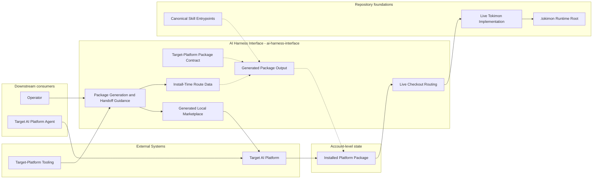
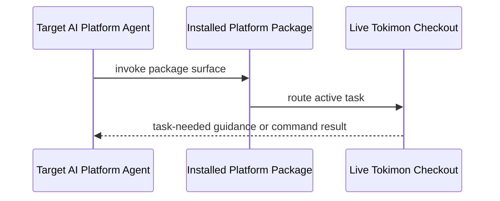
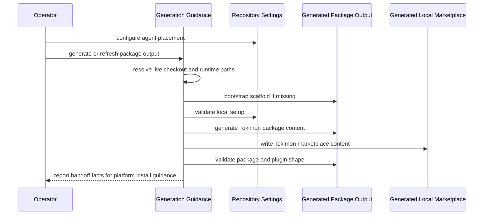
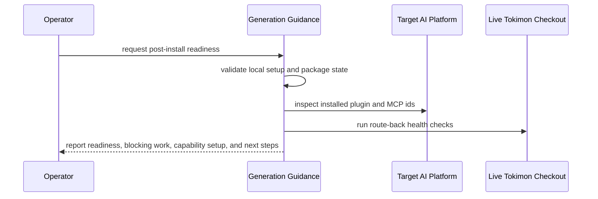

# AI Harness Interface - Containers

## Contents

1. [Overview](#overview)
2. [Container Diagram](#container-diagram)
3. [Containers](#containers)
4. [Key Interactions](#key-interactions)
5. [Security & Trust](#security--trust)
6. [Assumptions](#assumptions)
7. [Data Stores](#data-stores)
8. [References](#references)

## Overview

AI Harness Interface (`ai-harness-interface`) owns the packaging and distribution boundary between Tokimon and target AI platform packages.
The boundary exposes `using-tokimon` as the single startup-required skill and the skills and MCP entries selected by the host installation policy, while keeping live implementation and runtime state in the live checkout.

At a high level, the Codex adapter seeds supported compatibility structure with available legacy helpers or built-in authoring, then writes Tokimon-owned package content under `.tokimon/ai-harness-interface/codex/`.
The Claude Code adapter writes Tokimon-owned package content under `.tokimon/ai-harness-interface/claude/` without a scaffold step, because AI Harness Interface owns the Claude plugin manifest and marketplace content within the published Claude Code plugin schema, and it validates generated output through the Claude Code CLI when that CLI is available or required.
Both adapters inject resolved live-checkout and runtime paths into package entrypoints, expose Tokimon local marketplace content, and report install readiness; activation routes live work back to the configured checkout.

**Responsibilities**
- Own target-platform package and generated package-output contracts.
- Own install-time route fields needed for live-checkout routing.
- Own packaging and exposure of `using-tokimon`, copied root skill directories, Codex invocation metadata, and the supported MCP package set; the Skills and Memory containers own activation behavior.
- Own repository-local setup checks, Tokimon marketplace content, package validation, cache-refresh delegation, handoff facts, and post-install readiness reporting.
- Keep interface files as package entrypoints and route implementation work to live Tokimon surfaces.

**Non-responsibilities**
- Do not own OpenAI plugin schemas or legacy helper implementations.
- Do not own the Claude Code plugin schema, plugin cache, or `claude plugin` CLI behavior.
- Do not own account-level Codex or Claude Code plugin install or reinstall orchestration.
- Do not use target-platform package cache as the implementation source of truth.

## Container Diagram

## Containers

### Target-Platform Package Contract

- **Type:** Inbound Integration Interface Collection
- **Responsibility:** Own Tokimon package invariants while delegating platform-owned scaffold and shape mechanics to the selected target-platform tooling.
- **Technology:**
  - Codex plugin manifest.
  - Claude Code plugin manifest.
  - Packaged root skill directories.
  - Codex `agents/openai.yaml` skill metadata when present in the canonical skill.
  - MCP companion configuration.
  - Generated local marketplace manifest per target platform.
  - Codex plugin-creator scaffold, validator, and cachebuster helpers.
  - Claude Code CLI plugin validation helper.
- **Data:** Tokimon package catalog, route-back invariants, and target-platform tooling delegation boundaries.
- **Key interfaces:**
  - Tokimon manifest overlay contract.
  - Packaged root skill directory inventory.
  - Closed MCP package-membership and capability-to-server-id mapping from the shared tool catalog.
  - Tokimon local marketplace content contract.
  - Plugin-creator validation and cache-refresh adapter contract.

### Generated Package Output

- **Type:** Inbound Integration Interface Collection
- **Responsibility:** Materialize Tokimon-owned package content into a plugin-creator-seeded Codex package or a Tokimon-generated Claude Code package.
- **Technology:** Files under `.tokimon/ai-harness-interface/codex/plugins/tokimon/` and `.tokimon/ai-harness-interface/claude/plugins/tokimon/`.
- **Data:** Derived package files for Codex or Claude Code installation.
- **Key interfaces:**
  - Package files:
    - `.codex-plugin/plugin.json` for the Codex package
    - `.claude-plugin/plugin.json` for the Claude Code package
    - `.mcp.json`
    - `skills/<skill-id>/SKILL.md` for every packaged root skill
    - `skills/<skill-id>/agents/openai.yaml` when the canonical skill declares Codex metadata

### Generated Local Marketplace

- **Type:** Inbound Integration Interface Collection
- **Responsibility:** Write Tokimon local marketplace content while conforming to the marketplace shape contract of the selected target platform.
- **Technology:**
  - Codex: `.tokimon/ai-harness-interface/codex/.agents/plugins/marketplace.json`.
  - Claude Code: `.tokimon/ai-harness-interface/claude/.claude-plugin/marketplace.json`.
- **Data:** Marketplace name, marketplace owner or display identity, plugin source path, and platform-required plugin entry fields.
- **Key interfaces:**
  - Marketplace name `tokimon-local`.
  - Plugin id `tokimon`.
  - Source path `./plugins/tokimon`.

### Installed Platform Package

- **Type:** Inbound Integration Interface Collection
- **Responsibility:** Expose accepted Tokimon activation surfaces after account-level installation.
- **Technology:** Codex or Claude Code plugin cache and discovery surfaces.
- **Data:** Derived package copy in account-level platform storage.
- **Key interfaces:**
  - Startup bootstrap skill id `using-tokimon`.
  - Copied root skill directories.
  - Supported MCP server entries.

### Install-Time Route Data

- **Type:** Infrastructure
- **Responsibility:** Carry package-generation input values for live-checkout routing.
- **Technology:** CLI-resolved local paths from the checkout running package generation.
- **Data:**
  - `liveCheckoutPath`
  - `runtimeRoot`
- **Key interfaces:** Values baked into generated `SKILL.md` files and `.mcp.json`.

### Package Generation and Handoff Guidance

- **Type:** Tooling/Test
- **Responsibility:** Guide repository-local setup, scaffold bootstrap, package generation, validation, diagnostics, cachebuster delegation, target-platform handoff facts, and post-install readiness reporting.
- **Technology:**
  - Tokimon AI Harness Interface CLI.
  - Codex plugin-creator adapter.
  - Claude Code CLI adapter.
- **Data:** Route inputs, generated package paths, bootstrap evidence, validation evidence, cachebuster metadata, diagnostic evidence, handoff facts, readiness evidence, blocking remaining work, non-blocking capability setup, and next steps.
- **Key interfaces:**
  - Operator entrypoint: `.venv/bin/python -m tokimon.ai_harness_interface`.

### Live Checkout Routing

- **Type:** Infrastructure
- **Responsibility:** Route package activation and MCP entries to live Tokimon surfaces without duplicating implementation in package files.
- **Technology:**
  - Packaged root skill instructions.
  - Generated MCP command declarations.
- **Data:** Checkout pointer, runtime-root pointer, and activation context.
- **Key interfaces:**
  - Resolved paths embedded in generated skill text and MCP commands.
  - Task-needed live skill, workflow, tool, memory, and MCP command discovery.
  - Runtime writes under the configured runtime root.

## Key Interactions

### Interface Activation

1. The target AI platform agent invokes an installed package surface.
2. `using-tokimon` is the only startup-required skill; other heavyweight skills may disable implicit invocation in `agents/openai.yaml`.
3. The installed package uses generated routing instructions or generated MCP commands when live routing is needed.
4. The package routes the active task to the live checkout.
5. The agent loads only task-needed live resources and writes runtime state through Tokimon runtime paths.

### Generate and Handoff

1. The operator configures repository-local Tokimon settings for agent placement.
2. The operator asks an agent to generate or refresh package output for a selected target platform.
3. The agent resolves `liveCheckoutPath` and `runtimeRoot` from the checkout running package generation.
4. For Codex, the agent bootstraps missing Codex scaffold structure through plugin-creator tooling; the Claude Code adapter needs no scaffold step.
5. The agent validates setup and generates Tokimon-owned content in the selected platform's package root and marketplace file.
6. The agent validates generated files through Tokimon checks plus plugin-creator validation for Codex or Claude Code CLI validation for Claude Code.
7. The agent reports generated paths, route data, marketplace identity, and plugin id as handoff facts for target-platform install guidance.

### Post-Install Readiness

1. After account-level target-platform installation, the operator asks for post-install readiness.
2. The interface checks repository-local configuration, generated package validity, and install-time route data.
3. The interface inspects target-platform plugin and packaged MCP registration through read-only platform commands when supported.
4. The interface runs route-back health checks for every packaged MCP entry when requested.
5. The interface reports operational readiness separately from route-back health.
6. Missing external prerequisites are non-blocking capability setup, while package or route failures remain required work.

### Consumption Patterns

**Primary consumers:** Target AI platform agents, target platforms, and operators consume installed package, marketplace, generation, validation, handoff, and readiness surfaces.

**Dependencies consumed:** External Systems provide target-platform and plugin-creator tooling; Repository Components provide Mem Palace routes reached through packaged skill guidance, MCP contracts reached through package entries, and copied root skill entrypoints.

## Security & Trust

- Generated interface files store local paths only and must not store secrets.
- Interface files must route to live Tokimon surfaces and must not duplicate core implementation.
- The `using-tokimon` startup skill is the only startup activation exception; it runs the required bounded Mem Palace briefing, while `memory` is not a separate startup surface.
- Codex helper and built-in compatibility authoring stay behind the plugin-creator adapter. Claude Code plugin-shape validation stays behind the Claude Code CLI adapter.
- Installation never installs external dependencies. Missing Docker disables Docker-dependent surfaces; generation records the selected inventory outside the package.
- Public packages contain no ChatGPT website automation skill.
- Generated packages include the project license and applicable third-party license and attribution files from the source checkout.
- Generated and installed package files are derived artifacts and must not be hand-edited or committed.
- AI Harness Interface must not emit or run account-level `codex plugin` or `claude plugin` install or reinstall command plans.
- Account-level Codex install and reinstall guidance stays with plugin-creator and the target platform.
- Account-level Claude Code install and reinstall guidance stays with the install operation document and the Claude Code plugin CLI.
- Post-install readiness output must report secret presence and missing fields without printing secret values.

## Assumptions

- **Assumption:** The generation command runs from the intended live checkout.
- **Assumption:** Codex legacy plugin-creator tooling is optional unless explicitly required; built-in authoring follows the supported compatibility format.
- **Assumption:** The Claude Code CLI is available when Claude plugin-shape validation or read-only Claude platform inspection is required.
- **Assumption:** Platform discovery may require a new session after interface changes.

## Data Stores

- **Owned stores:**
  - Generated package output under `.tokimon/ai-harness-interface/codex/plugins/tokimon/`.
  - Generated local marketplace file `.tokimon/ai-harness-interface/codex/.agents/plugins/marketplace.json`.
  - Generated package output under `.tokimon/ai-harness-interface/claude/plugins/tokimon/`.
  - Generated local marketplace file `.tokimon/ai-harness-interface/claude/.claude-plugin/marketplace.json`.
- **Dependency stores:**
  - Repository-local Tokimon settings under `.tokimon/settings.local.json`.
  - Account-level target-platform package storage.
  - Live Tokimon checkout.
  - `.tokimon/` runtime root.

## References

- L1 Context: `docs/c4/level-1-context/ai-harness-interface-context.md`
- Memory Context: `docs/c4/level-1-context/memory-context.md`
- Tools Context: `docs/c4/level-1-context/tools-context.md`
- Workflow Context: `docs/c4/level-1-context/workflow-context.md`
- Skills Context: `docs/c4/level-1-context/skills-context.md`
- Guidelines: `docs/guidelines/repository-guidelines.md`
