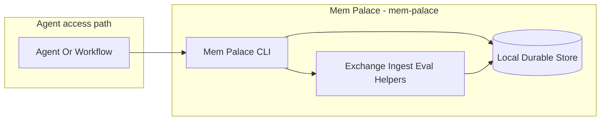
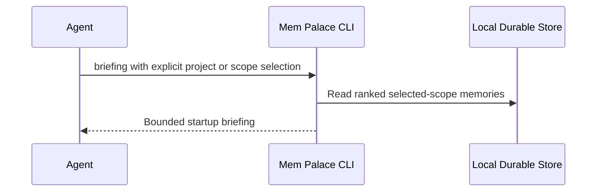
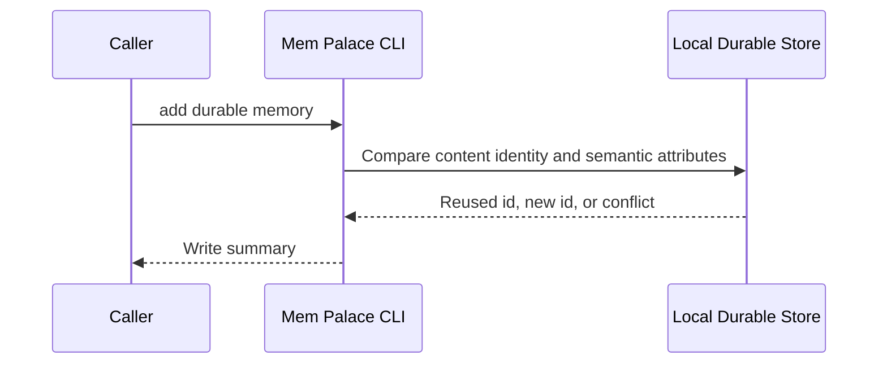
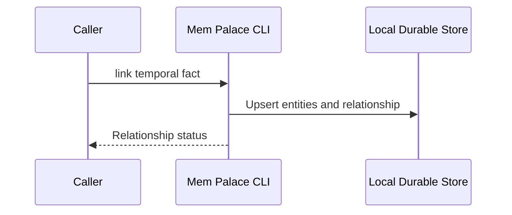
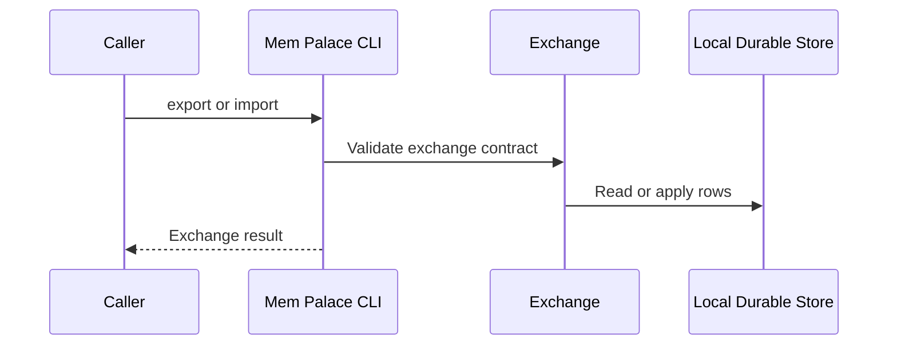
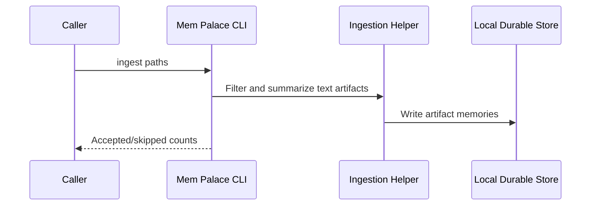
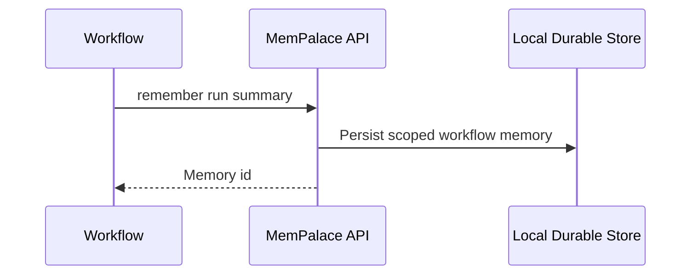

# Mem Palace - Containers

This document owns the L2 container boundary for Mem Palace.

## Contents

1. [Overview](#overview)
2. [Container Diagram](#container-diagram)
3. [Containers](#containers)
4. [Key Interactions](#key-interactions)
5. [Security & Trust](#security--trust)
6. [Data Stores](#data-stores)
7. [References](#references)

## Overview

Mem Palace (`mem-palace`) is the local durable memory body for Tokimon.
It preserves local context that should survive future Codex sessions on this machine:
- user preferences
- stable local decisions
- machine-local facts
- temporal relationships
- short continuity notes

At a high level, the Mem Palace CLI reads and writes a local SQLite store and delegates portable exchange, ingestion, and recall evaluation to focused helpers.
Workflows may write durable run continuity through the Python facade, while repository architecture remains owned by C4.

**Responsibilities**
- Store, rank, retrieve, and render scoped durable local memory.
- Derive adopting-project memory scopes from an explicit project root while preserving one shared scope across linked Git worktrees.
- Keep content identity stable while refusing silent semantic-attribute loss during duplicate add and import operations.
- Preserve temporal entity relationships when facts can change over time.
- Provide portable JSONL export/import, local backups, conservative artifact ingestion, and recall evaluation.
- Provide explicit bounded briefing and search without implicitly loading repository documents.

**Non-responsibilities**
- Do not replace C4 as the repository self-description.
- Do not store secrets, tokens, cookies, passwords, or sensitive headers.
- Do not require host-level backup behavior; host recovery stays outside Tokimon.
- Do not let callers write `.tokimon/memory/memory.db` directly.

## Container Diagram

## Containers

### Mem Palace CLI
- **Type:** CLI Runtime
- **Responsibility:** Store, rank, list, and render scoped durable local memories plus temporal entity facts.
- **Technology:** Python standard library CLI.
- **Data:** Read/write access to `.tokimon/memory/memory.db`.
- **Key interfaces:**
  - Operator entrypoint:
    - `.venv/bin/python -m tokimon.memory.mem_palace.mem_palace`
  - Operator command families:
    - bounded context and retrieval
    - durable writes and temporal relationships
    - portable exchange, local snapshots, explicit artifact ingestion, and recall evaluation
  - Python facade:
    - `MemPalace`
  - Default database path:
    - `.tokimon/memory/memory.db`

### Memory Exchange, Ingestion, and Evaluation
- **Type:** API Runtime
- **Responsibility:** Keep portable JSONL exchange, local SQLite snapshots, conservative artifact ingestion, and recall evaluation behind standalone helpers.
- **Technology:** Python standard library API runtime.
- **Data:** Explicit files supplied by callers, JSONL exchange files, sidecar exchange manifests, local SQLite snapshots, and recall fixture files.
- **Key interfaces:**
  - Exchange contract:
    - portable JSONL export/import with manifest validation.
  - Ingestion contract:
    - explicit artifact paths supplied by callers.
  - Evaluation contract:
    - local recall fixture input and result artifacts.

### Local Durable Store
- **Type:** Data Store
- **Responsibility:** Persist local durable memory records, retrieval metadata, temporal entity relationships, and local store metadata.
- **Technology:** SQLite with FTS5 when available.
- **Data:** Local durable memory and temporal relationship records.
- **Key interfaces:**
  - Default path: `.tokimon/memory/memory.db`
  - Local snapshot output: `.tokimon/memory/backups/`
  - Written and queried only through the Mem Palace CLI or `MemPalace` Python API.

## Key Interactions

### Startup Memory Read
1. A Tokimon repository session runs one bounded `.venv/bin/python -m tokimon.memory.mem_palace.mem_palace briefing --scope tokimon --limit 8` before substantive work unless the session or task already has a current briefing.
2. An installed Tokimon caller instead passes `--project-root <current-task-repository-root> --include-scope global`, deriving memory from the adopting project rather than the Tokimon implementation checkout.
3. The CLI prints the repository guidelines.
4. The CLI prints essential local memories, then recent durable Mem Palace entries from the selected project and explicitly included scopes.
5. Explicit general-purpose callers may omit both `--scope` and `--project-root` to request the generic cross-scope briefing; the CLI default remains unscoped.

### Durable Memory Write
1. A durable local fact or preference is learned.
2. The caller runs `.venv/bin/python -m tokimon.memory.mem_palace.mem_palace add`.
3. The CLI computes a stable content identity, then compares semantic attributes when that identity already exists.
4. An exact duplicate reuses its existing row, while a mismatch in pinned state, entities, importance, confidence, or metadata fails without changing the stored row unless the caller explicitly allows a duplicate.
5. A correction may name existing older rows in `metadata.supersedes_memory_ids`; bounded/default retrieval then omits those older rows while direct inspection and exchange retain them.
6. Future sessions retrieve the effective stored row through `briefing`, `recent`, `search`, `show`, or the `MemPalace` Python API.

### Temporal Fact Write
1. A fact should be queryable as a relationship that can change over time.
2. The caller runs `.venv/bin/python -m tokimon.memory.mem_palace.mem_palace link <subject> <predicate> <object> --valid-from <date>`.
3. The local SQLite store upserts entity nodes and stores the relationship.
4. Future sessions query it with `entity`, `timeline`, or `MemPalace.entity_facts(...)`.

### Portable Exchange
1. A caller runs `backup`, `export --output <path>`, or `import <path>` through the Mem Palace CLI.
2. Export produces portable JSONL plus a sibling manifest.
3. Import validates the exchange contract and each memory's canonical content identity before applying rows.
4. Default duplicate suppression skips only an exact semantic-attribute match; a same-content attribute conflict aborts the transaction unless the caller explicitly keeps duplicate memories.
5. Without replacement, an exported memory identifier already occupied by an unrelated destination row receives a fresh destination identifier; relationship provenance and supersession references are rewritten through the resulting source-to-destination memory map.
6. Explicit replacement keeps the exported memory identifier and replaces its destination row.
7. Legacy JSONL without a manifest requires `import <path> --no-manifest` and still receives per-row schema validation.
8. Import applies rows inside one SQLite transaction so validation or apply errors leave the destination store unchanged.

### Conservative Artifact Ingestion
1. A caller explicitly names files or directories with `ingest`.
2. The ingestion helper skips runtime folders, large files, binary files, and unsupported extensions.
3. Each accepted text document becomes a scoped `artifact` memory with path/hash metadata and bounded details.

### Workflow Consumer Write
1. A workflow finishes a run.
2. The workflow calls `MemPalace.remember(...)`.
3. The run summary is stored under `scope=workflow` and the workflow's room for future recall.

### Consumption Patterns

**Primary consumers:** Agents and workflows consume bounded briefing, search, temporal fact, and `MemPalace` facade surfaces.

**Dependencies consumed:** Repository Components provide the local durable memory body, portable exchange artifacts, local backups, and explicit recall.

## Security & Trust

- Mem Palace is local-only runtime state and must not store secrets, tokens, cookies, passwords, sensitive headers, or full auth/session material.
- Callers read and write memory through the CLI or `MemPalace` Python API; direct database mutation is outside the supported contract.
- Portable exchange files may contain durable user preferences or machine facts and should be handled as local sensitive artifacts.
- Mem Palace backup/export commands provide local snapshots and portable exchange only; host-level recovery stays outside Tokimon.

## Data Stores

- **Owned stores:**
  - `.tokimon/memory/memory.db`
  - `.tokimon/memory/backups/`

## References

- L1 Context: `docs/c4/level-1-context/memory-context.md`
