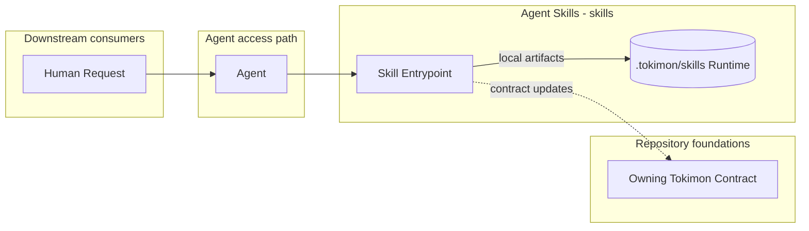
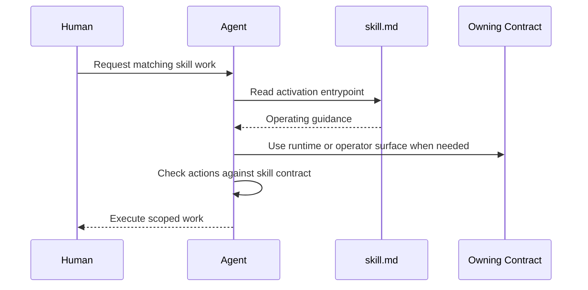

# Agent Skills - Containers

## Contents

1. [Overview](#overview)
2. [Container Diagram](#container-diagram)
3. [Containers](#containers)
4. [Key Interactions](#key-interactions)
5. [Security & Trust](#security--trust)
6. [Data Stores](#data-stores)
7. [References](#references)

## Overview

Agent Skills (`skills`) is the agent-facing operating-guide collection for Tokimon.
It owns repo-shareable skill entrypoints that agents read before planning, editing, or running repeatable Tokimon work.

At a high level, the `skills/` root stores one directory per skill and uses `skill.md` as the activation entrypoint.
Optional `agents/openai.yaml` files declare Codex presentation, invocation policy, and tool dependencies without changing the portable skill instructions.
Skill entrypoints are self-contained operating manuals that may call workflow, tool, or operations surfaces.

C4 remains design, architecture, contract, and audit evidence rather than the normal skill activation path.
Installed skill runtime state resolves under Tokimon's configured runtime root, not under a subject repository.

**Responsibilities**
- Own skill directory layout, entrypoint metadata, and local skill runtime root conventions.
- Own optional target-platform skill metadata while keeping portable behavior in `skill.md`.
- Provide complete operating guidance for repeatable agent work.
- Own product-development guidance through acceptance of the uncommitted implementation after required verification.
  The human operator owns commits and PR creation after handoff.
- Run product-development analysis and review in the active Agent runtime using repository and runtime evidence.
- Record whether product-development review uses the primary Agent or an authorized independent reviewer.
  Additional reviewers are optional; Pair requires explicit human invocation.
- Require agents to treat activated skill entrypoints as execution contracts before claiming compliance or advancing dependent workflow gates.
- Keep the default browser-surface order in `using-tokimon`. Specialized skills and workflows may require a particular surface for task-specific capabilities, but must not define another default order.
- Keep normal skill activation independent from C4 document loading.
- Route architecture, command-contract, and workflow behavior changes back to owning C4 documents as design or contract updates.
- Keep skill-local artifacts under `.tokimon/skills/<skill-name>/`.
- Define any skill-owned bounded automation waiver explicitly in the activating skill and route git mutations through the git skill.

**Non-responsibilities**
- Do not replace C4 architecture contracts, workflow package contracts, tool registry entries, or tests.
- Do not own implementation behavior for memory, tools, or workflows.
- Do not store secrets, credentials, cookies, browser state, or API tokens.

## Container Diagram

## Containers

### Skills Directory

- **Type:** Agent Operating Guide Collection
- **Responsibility:** Store shareable skill entrypoints that agents can read before planning or editing.
- **Technology:**
  - Markdown skill entrypoints under `skills/`.
  - Optional YAML metadata under `skills/`.
- **Data:** Skill frontmatter, self-contained operating guidance, invocation policy, tool dependencies, runtime roots, and command-surface references.
- **Key interfaces:**
  - Skill paths:
    - `skills/`
    - `skills/<skill-name>/`
    - `skills/<skill-name>/skill.md`
    - `skills/<skill-name>/agents/openai.yaml`
  - Runtime roots:
    - `.tokimon/skills/<skill-name>/`

## Key Interactions

### Skill Activation

1. A user request matches a repo skill.
2. The agent reads `skills/<skill-name>/skill.md`.
3. The skill provides the normal operating procedure and routes command discovery through CLI help, workflow contract output, operations docs, or tool surfaces as needed.
4. Before claiming the skill was followed, the agent checks actual actions against required steps, guardrails, and output contract.
5. Skill-owned local artifacts, when needed, are written under `.tokimon/skills/<skill-name>/`.

### Consumption Patterns

**Primary consumers:** Agents consume `skills/<skill-name>/skill.md` before planning or editing when a user request matches a repo skill.

**Dependencies consumed:** Repository Components provide contract output and command help for workflow-backed skills; Agent Interfaces provide tool surfaces for tool-backed skills.

## Security & Trust

- The public skill catalog contains no ChatGPT website automation or automatic answer collection.

- Skill guidance may reference local runtime roots but must keep generated artifacts under `.tokimon/skills/<skill-name>/`.
- Subject repositories are product targets, not storage roots for Tokimon-owned skill runtime artifacts unless they explicitly are the Tokimon runtime owner.
- Skills that waive per-commit confirmation for bounded automation must name the boundary and must not permit merging, force-pushing, unrelated staging, or cross-branch mutation.

## Data Stores

- **Owned stores:**
  - `.tokimon/skills/<skill-name>/` for skill-local artifacts, drafts, continuity state, and handoff packets.

## References

- L1 Context: `docs/c4/level-1-context/skills-context.md`
