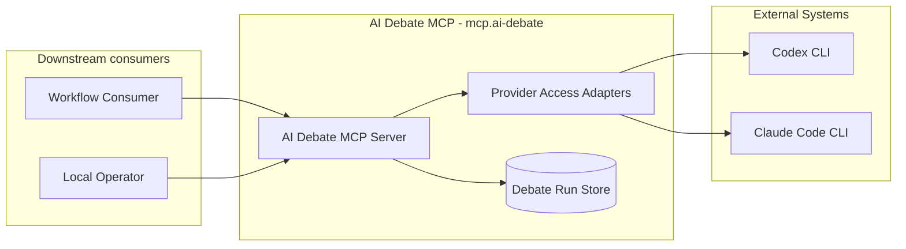
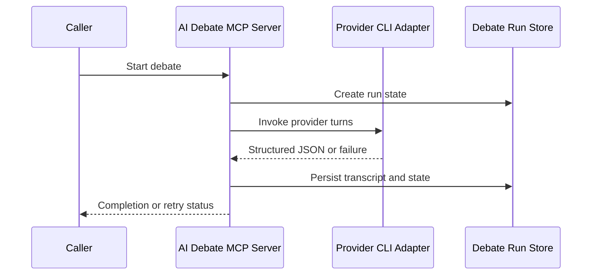
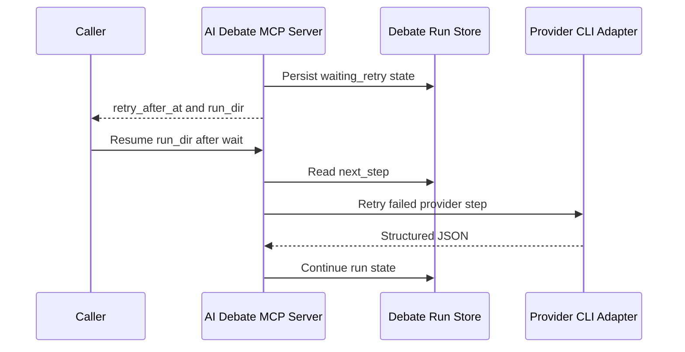
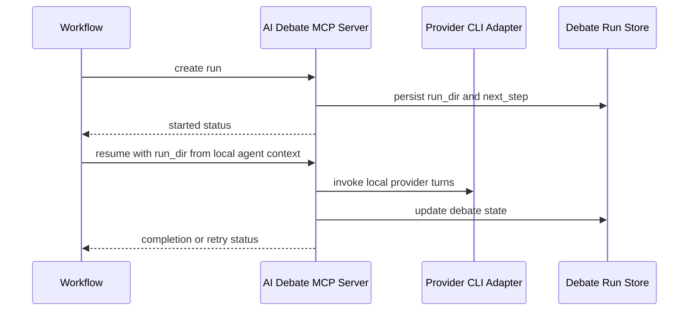

# AI Debate MCP - Containers

## Contents

1. [Overview](#overview)
2. [Container Diagram](#container-diagram)
3. [Containers](#containers)
4. [Key Interactions](#key-interactions)
5. [Security & Trust](#security--trust)
6. [Data Stores](#data-stores)
7. [References](#references)

## Overview

The AI Debate MCP capability (`mcp.ai-debate`) is the tools-layer container for adversarial multi-round AI-to-AI debate and final judgment.
It gives workflows and operators one reusable debate surface while the tools layer owns the protocol and runtime state.

At a high level, callers submit opposing positions, and provider adapters advance alternating turns through final judgment.
The run store persists debate state while the server returns machine-readable lifecycle status.
Workflows consume the results without owning provider execution or debate-state mechanics.

**Responsibilities**
- Expose MCP and local CLI surfaces for debate health, run, resume, status, and transcript reads.
- Invoke Codex and Claude Code through local provider CLIs.
- Preserve the debate protocol—opposing roles, alternating turns, stop signals, and judge-owned final decisions—together with deterministic state, ordered transcripts, retry metadata, and outcomes.
- Keep valid historical runs readable without restoring retired remote-broker execution.
- Persist artifacts only on the local filesystem, under `.tokimon/tools/mcp/ai-debate/` by default or a caller-selected allowed output root.

**Non-responsibilities**
- Do not own domain-specific prompts that consume debate output.
- Do not make workflow-level decisions from debate output.
- Do not replace Pair's exact-text consensus or generic subagent delegation; AI Debate is for adversarial rounds ending in judgment.

## Container Diagram

## Containers

### AI Debate MCP Server
- **Type:** API Runtime
- **Responsibility:** Provide MCP and local CLI operations for debate health, run creation, resume, status reads, and transcript reads.
- **Technology:** `.venv` Python stdio MCP server and CLI.
- **Data:** Debate configuration, turn state, transcript summaries, status payloads, and retry metadata.
- **Key interfaces:**
  - Capability id:
    - `mcp.ai-debate`
  - Operator entrypoint:
    - `.venv/bin/python -m tokimon.tools.mcp.ai_debate serve`
  - Local diagnostics:
    - `.venv/bin/python -m tokimon.tools.mcp.ai_debate health --json`
  - MCP tool families:
    - health and run lifecycle.
    - status and transcript reads.
  - Packaged server id:
    - `tokimon-ai-debate`.

### Provider Access Adapters
- **Type:** Tool Adapter
- **Responsibility:** Resolve and invoke supported AI providers for debater and judge turns through local CLI access.
- **Technology:**
  - `.venv` Python provider adapters.
  - Local Codex CLI.
  - Local Claude Code CLI.
- **Data:** Provider prompts, structured-output schemas, stdout/stderr captures, validated JSON turn payloads, and provider failure metadata.
- **Key interfaces:**
  - Provider access families:
    - Local provider CLI access with `access=local-cli`.
  - Default provider result path:
    - `.tokimon/tools/mcp/ai-debate/runs/<run_id>/`

### Debate Run Store
- **Type:** Data Store
- **Responsibility:** Persist each run's transcript, configuration, state, prompts, per-turn results, and runtime version evidence.
- **Technology:** Local filesystem, defaulting to `.tokimon/tools/mcp/ai-debate/runs/`.
- **Data:**
  - Debate transcript and configuration artifacts.
  - Per-turn prompt and result artifacts.
  - Provider stdout, stderr, and runtime-version artifacts.
- **Key interfaces:**
  - Run directory:
    - returned by `ai_debate_run`.
  - Resume handle:
    - consumed by `ai_debate_resume`.

## Key Interactions

### Fresh Debate Run
1. A workflow or operator calls `mcp.ai-debate` with debate topic, sides, provider options, and output root.
2. The server creates a run directory and writes the run configuration.
3. Provider adapters execute debater turns and the final judge when needed.
4. The server updates `state.json`, appends the transcript, and returns completed or resumable status.

### Retryable Provider Resume
1. A provider quota, rate-limit, or token-exhaustion failure stops the run with `waiting_retry`.
2. The server records retry metadata and returns without sleeping.
3. A caller waits externally until the retry time and calls resume with the same run directory.
4. The server retries the persisted `next_step` without advancing the transcript prematurely.

### Timeout-Sensitive Local Resume

1. The workflow creates the run before starting the provider turn and keeps the returned `run_dir`.
2. The server records the next local provider step without launching a durable remote job.
3. A local agent context calls resume with the persisted `run_dir` when it is ready to execute provider turns.
4. The compatibility async lifecycle tools remain present for older clients.
   They fail fast because local CLI access has no durable broker job handle.

Historical remote-broker runs remain readable but cannot restart remote execution.
Completed runs return their existing summary; incomplete runs return a resume error with that summary.
Remote-only persisted forms are accepted only for validated historical remote-broker runs.

### Consumption Patterns

**Primary consumers:** Workflows and local operators consume debate lifecycle, health, and transcript surfaces across debate-backed work.

**Dependencies consumed:** External Systems provide provider CLIs and authentication; Repository Components provide registry availability for `mcp.ai-debate`.

## Security & Trust

- Provider authentication stays in installed CLIs and environment configuration; the MCP server never accepts or stores provider credentials.
- `.tokimon/settings.local.json` selects the access path and Peer B provider; invocation arguments may override placement.
- Callers read the main thread's active model and effort following `docs/guidelines/configuration-guidelines.md` and pass both to provider execution.
- Debate artifacts stay on the local filesystem and may include prompts, transcripts, and provider stdout/stderr.
- Artifact reads cannot escape the selected run boundary; write targets also reject symbolic-link-backed paths.
- Persisted run state and task results are cross-validated before reuse; compatibility exceptions apply only to validated historical remote-broker runs.
- Provider processes honor configured deadlines; stalled or incomplete execution is terminated and recorded as a provider failure.

## Data Stores

- **Owned stores:** Local run directories, defaulting to `.tokimon/tools/mcp/ai-debate/runs/`.
- **Dependency stores:**
  - `.tokimon/settings.local.json`
  - Provider CLI authentication and configuration outside this repository.

## References

- L1 Context: `docs/c4/level-1-context/tools-context.md`
- Guidelines: `docs/guidelines/configuration-guidelines.md`
