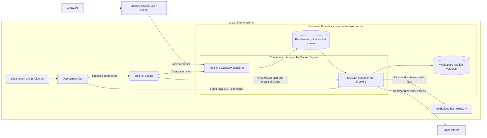
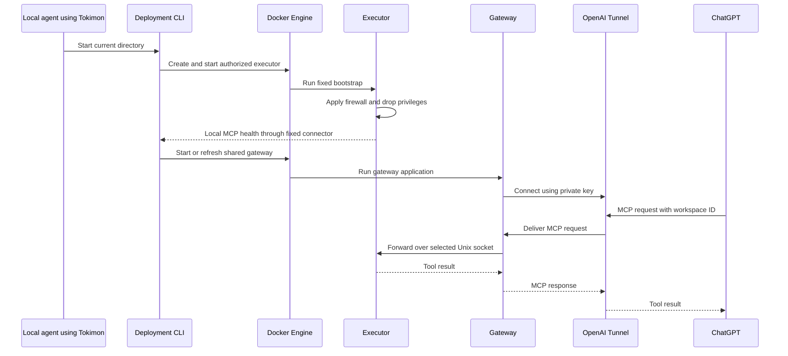
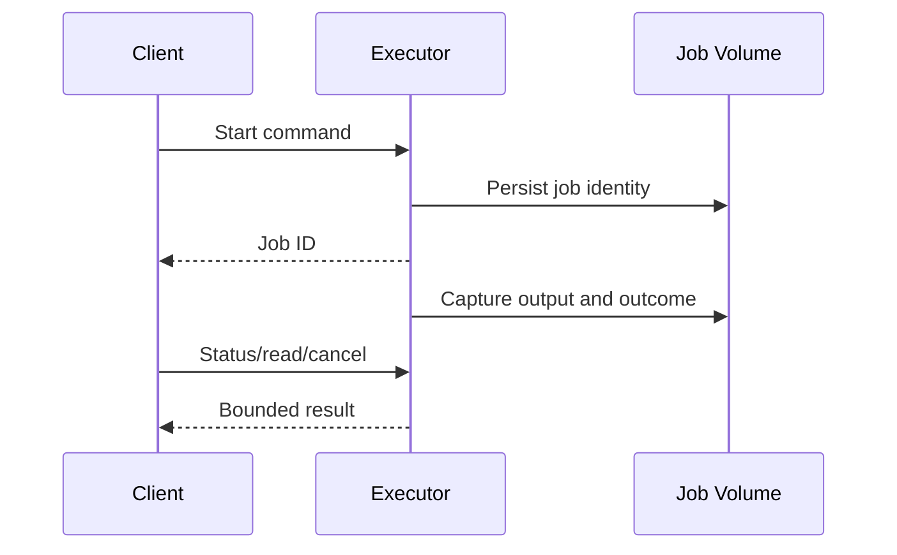

# Container Executor MCP - Containers

## Contents

1. [Overview](#overview)
2. [Container Diagram](#container-diagram)
3. [Containers](#containers)
4. [Key Interactions](#key-interactions)
5. [Security & Trust](#security--trust)
6. [Assumptions](#assumptions)
7. [Data Stores](#data-stores)
8. [References](#references)

## Overview

Container Executor (`mcp.container-executor`) provides long-lived MCP command and file tools inside a Docker execution boundary.
Tool execution uses ordinary programs, independently of AI provider CLIs or Codex/Work allowance.

At a high level, Tokimon runs one Executor container per authorized directory and one shared Machine Gateway container within the operator's selected Tokimon runtime.
The local agent invokes the Deployment CLI, which asks the already-running Docker Engine to manage these containers.
ChatGPT requests travel through the official OpenAI Tunnel Client in the gateway to each executor's Unix socket.
The executor has direct public internet connectivity and explicitly configured host directory mounts.

**Responsibilities**
- Run asynchronous shell jobs with bounded time, output, and concurrency; retain status across client disconnects.
- Provide bounded file operations in persistent workspace and declared mounts.
- Configure container-local network isolation before publishing tools and permanently discard bootstrap privileges.
- Manage installation, startup, shutdown, diagnosis, updates, rollback, and uninstall through owned Docker resources.

**Non-responsibilities**
- Run AI models or delegate tool execution to Codex, Work, or another AI CLI.
- Own application-specific tools or business rules.
- Provide a virtual-machine security boundary, immutable audit storage, or adversarial process-tree containment.
- Automatically create or delete remote tunnels, API keys, or ChatGPT connectors.

## Container Diagram

## Containers

### Deployment CLI
- **Type:** CLI Runtime
- **Responsibility:** Validate owner configuration, build immutable revisions, and manage exact deployment-owned resources.
- **Technology:**
  - Repository `.venv` Python.
  - Local Docker CLI.
- **Data:** Owned revision manifests, image/container/volume identities, mount and network policy, and lifecycle journal.
- **Key interfaces:**
  - Capability: `mcp.container-executor`.
  - Entrypoint: `.venv/bin/python -m tokimon.tools.mcp.container_executor`.
  - Operator families: configuration, lifecycle, diagnosis, and stdio connection.
  - Directory service family: `workspace` commands, surfaced through the packaged `container-executor` skill.

### Executor
- **Type:** Tool Runtime
- **Responsibility:** Execute authorized commands and file operations after isolation setup, persist bounded job artifacts, and recover interrupted jobs.
- **Technology:**
  - Linux Docker container.
  - Python standard library.
  - Shell/program tools.
  - Container-native nftables.
- **Data:** Owned job state and output; read/write workspace; declared read-only or read/write mounts.
- **Key interfaces:**
  - MCP command, job, file, and health tool families.
  - Private JSON-line Unix socket at `/run/tokimon/mcp.sock`.

### Machine Gateway
- **Type:** Tool Adapter
- **Responsibility:** Maintain that runtime's stable Tunnel endpoint and dispatch fixed tools by explicit workspace identity without controlling worker lifecycle.
- **Technology:**
  - Unprivileged Docker container.
  - Python stdio MCP dispatcher.
  - Optional official `tunnel-client` binary.
- **Data:** Read-only registered socket volumes and immutable route snapshot; gateway-only key mount; transient tunnel profile.
- **Key interfaces:** Workspace discovery and workspace-aware execution tools through one OpenAI Secure MCP Tunnel.

## Key Interactions

### Start and Connect
1. Initialization validates and saves machine connection references without starting containers.
2. The local agent invokes directory start; the CLI snapshots host networks and asks Docker to start one executor.
3. The fixed executor bootstrap installs namespace-local rules and drops every capability and root identity before publishing MCP.
4. The first directory starts the shared gateway; later directories update its routes while executor jobs continue.
5. ChatGPT calls the gateway, which forwards to the explicitly selected executor. Stopping the final directory stops the gateway.

### Persistent Job
1. A client starts a command and receives a job ID.
2. The executor captures bounded output and terminal status independently of the client connection.
3. Any authorized connection to the same deployment can inspect or cancel that job.

### Consumption Patterns

**Primary consumers:** Authorized MCP clients consume independent command, job, and file tools; operators consume deployment lifecycle and diagnosis.

**Dependencies consumed:** External Systems provide local Docker, Linux network isolation, and public internet; Platform Services optionally provide OpenAI Secure MCP Tunnel; Repository Components provide capability discovery.

## Security & Trust

- The executor shares the host kernel but no host namespaces, devices, or Docker control socket.
  Its fixed read-only bootstrap temporarily has only network and identity-management capabilities; actual service and command processes have nonzero UID/GID, empty supplementary groups, all capability masks zero, and `NoNewPrivs=1`.
- Internet access is direct and always enabled for ordinary public IPv4 TCP/UDP operations, rather than HTTP-proxy-only access.
  Namespace-local rules reject nonpublic destinations, discovered host addresses/directly connected prefixes, configured additional blocked networks, and IPv6; inbound connections and forwarding are denied.
  Container loopback and Docker DNS remain usable.
  Host addressing/routing changes require policy refresh through restart; externally published host/NAT addresses must be included in the additional blocked networks.
- No host data is mounted by default.
  Declared directories appear only under `/mounts/<alias>`; broad host roots and Docker/runtime-control paths are refused.
  Directory start explicitly grants the current project read/write access with inaccessible readonly overlays covering known sensitive children, the Tunnel key directory and declared protected descendants.
  The Tokimon checkout and non-secret runtime files remain accessible when their containing project is granted; protection never expands the key directory to its containing checkout.
  Unsafe or unmaskable grants are refused; newly added sensitive paths require stop/start to refresh the protection snapshot.
  Read/write mounts change host files directly and are not reverted by image rollback.
- Local management and stdio use a fixed connector inside the executor, with the same complete privilege drop before request processing; they never execute a host shell or caller-supplied bootstrap code.
  The machine gateway has only registered socket volumes and no Docker API or project mounts, and drops all capabilities from startup.
  The gateway alone mounts the private Tunnel key and runs the official client; protected project grants hide the key's containing directory from executors.
- A deployment is one authorized owner's shared workspace and job history, not isolation between mutually untrusted clients.
  Commands can affect their own writable data and service processes; job timeout/cancel targets process groups, while stopping the container clears all remaining processes.
- CPU, memory, PID count, tmpfs, tool requests, job output, job count, and Docker log growth are bounded.
  Persistent workspace/bind-mount disk quotas belong to the operator's filesystem, independently of output limits.

## Assumptions

- **Assumption:** The selected Docker endpoint is a local rootful Linux Engine, and its kernel permits container-native nftables and capability revocation; rootless, Desktop and remote endpoints are rejected.
- **Assumption:** The operator owns Docker administration, mount authorization, and the deployment configuration.
- **Assumption:** Optional Tunnel credentials have the correct Platform organization and tunnel permissions; client-specific availability is verified separately.

## Data Stores

- **Owned stores:** Deployment configuration, revisions and journal under `.tokimon/tools/mcp/container-executor/`; machine profile, directory registry and gateway revisions under its `workspaces/`; exact labeled Docker workspace, job, and socket volumes.
- **Dependency stores:** Explicit host mount directories; optional owner-provided key file; official Tunnel Client download; local Docker image and network storage.

## References

- L1 Context: `docs/c4/level-1-context/tools-context.md`
- Skill: `skills/container-executor/skill.md`
