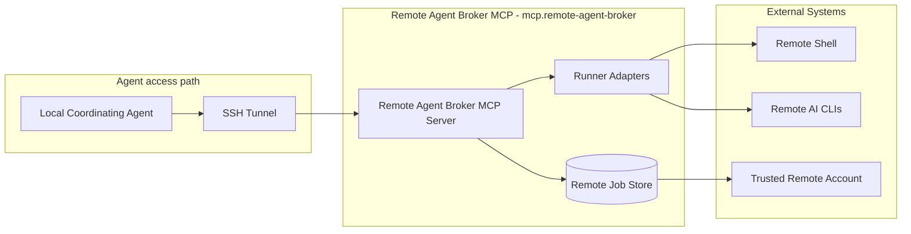
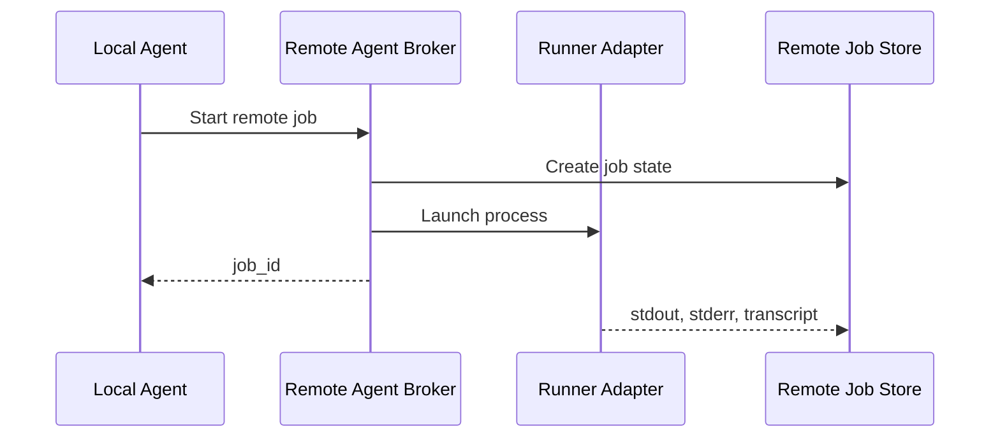
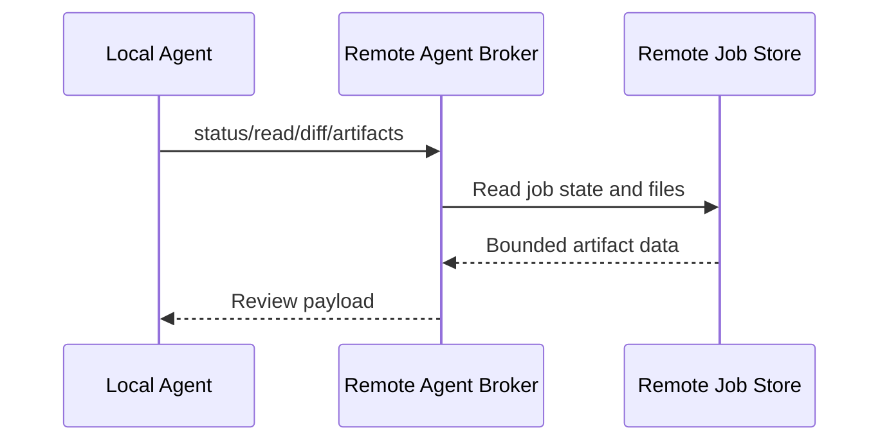

# Remote Agent Broker MCP - Containers

## Contents

1. [Overview](#overview)
2. [Container Diagram](#container-diagram)
3. [Containers](#containers)
4. [Key Interactions](#key-interactions)
5. [Security & Trust](#security--trust)
6. [Data Stores](#data-stores)
7. [References](#references)

## Overview

Remote Agent Broker MCP (`mcp.remote-agent-broker`) is the tools-layer container for running trusted remote shell and AI CLI jobs through MCP.
It gives a local coordinating agent one asynchronous job lifecycle for shell, Claude Code, Copilot, and other non-Codex remote runners.
Codex-native SSH, remote connections, worktrees, handoff, and subagents own Codex remote execution.

At a high level, the HTTP MCP broker runs in the trusted remote account, accepts job requests through a loopback-bound endpoint, invokes runner adapters, and stores reviewable job artifacts under `.tokimon/tools/mcp/remote-agent/`.
The broker is convenience-first for environments where the same operator already has SSH access to the remote account.

**Responsibilities**
- Expose MCP tools for remote shell and remote AI-agent job execution.
- Preserve one outer job lifecycle across supported runner adapters.
- Preserve one monotonic job-state history across concurrent output, status, cancellation, and completion activity.
- Return status, output, diffs, and artifact paths for local review.
- Bind to remote-host loopback by default and rely on SSH tunnels for local access.
- Keep secrets, credentials, cookies, auth codes, and environment dumps out of persisted artifacts.

**Non-responsibilities**
- Do not act as a hard sandbox for the remote account.
- Do not replace SSH security, account isolation, server firewalling, or host policy.
- Do not own cross-machine file sync, PR creation, or multi-agent orchestration policy.
- Do not proxy Codex CLI jobs that the Codex platform can execute through native remote connections or subagents.
- Do not expose the broker on LAN or public interfaces by default.

## Container Diagram

## Containers

### Remote Agent Broker MCP Server
- **Type:** API Runtime
- **Responsibility:** Provide HTTP MCP transport, job lifecycle management, status/read/cancel/diff/artifact operations, and remote shell convenience execution.
- **Technology:**
  - `.venv` Python.
  - HTTP MCP transport.
- **Data:** MCP request-correlation context, job ids, runner metadata, job status, captured output, and artifact paths.
- **Key interfaces:**
  - Capability id:
    - `mcp.remote-agent-broker`
  - Default endpoint:
    - `http://127.0.0.1:8938/mcp`
  - Operator entrypoint:
    - `.venv/bin/python -m tokimon.tools.mcp.remote_agent_broker serve-http --host 127.0.0.1 --port 8938`
  - Remote job operation family:
    - start
    - status/read
    - cancel
    - diff/artifacts

### Runner Adapters
- **Type:** Tool Adapter
- **Responsibility:** Translate the unified job lifecycle into runner-specific shell, Claude Code, or Copilot CLI process behavior.
- **Technology:**
  - Remote host shell.
  - Configured runner CLI executables discovered from the remote account.
- **Data:** Prompts, runner options, process metadata, stdout, stderr, transcripts, final outputs, and diff artifacts.
- **Key interfaces:**
  - Runner option family:
    - runner-specific options remain inside `runner_options`.
  - Runner-specific executable override configuration.

### Remote Job Store
- **Type:** Data Store
- **Responsibility:** Persist local-only job state and review artifacts on the remote host while preserving one authoritative, monotonic state history per job.
- **Technology:** Filesystem artifacts under `.tokimon/tools/mcp/remote-agent/jobs/<job_id>/`.
- **Data:** Job metadata, stdout, stderr, transcripts, final output, diff artifacts, cancellation state, and retention metadata.
- **Key interfaces:**
  - `job_id` returned by start operations.
  - Artifact paths returned by status/read/artifact operations.

### Trusted Remote Account
- **Type:** Infrastructure
- **Responsibility:** Provide the execution account, host permissions, filesystem, shell, installed AI CLIs, and network environment used by broker jobs.
- **Technology:** Ubuntu remote account reached through SSH and loopback-bound HTTP MCP.
- **Data:** Remote working trees, shell environment, runner authentication, and local `.tokimon/` runtime state.
- **Key interfaces:**
  - SSH tunnel from local client to remote loopback endpoint.
  - Remote working directory supplied per job.

## Key Interactions

### Remote Job Start
1. The local coordinating agent connects through an SSH tunnel to the remote broker endpoint.
2. The agent starts a shell or AI runner job with a remote working directory and prompt or command.
3. The broker records the originating request/session correlation with a job id, starts the process, and writes job state under `.tokimon/tools/mcp/remote-agent/`.
4. The caller receives the job id quickly and polls or reads artifacts later.

The broker publishes terminal artifacts only after bounded output capture completes or a visible capture failure is recorded, and it keeps lifecycle updates durable.
Structured accepted/completed events carry the same request correlation and generated job id as the persisted state.

### Remote Job Review
1. The local coordinating agent asks for job status, incremental output, artifacts, or diff.
2. The broker reads the persisted job state and captured files.
3. The broker returns bounded output or artifact paths for local review.

The broker preserves one terminal outcome and keeps cancellation or signalling failures visible for review.

### Consumption Patterns

**Primary consumers:** Local coordinating agents and operators consume the asynchronous remote job contract across configured remote runners.

**Dependencies consumed:** External Systems provide SSH transport, the trusted remote host, and installed remote runner CLIs; Repository Components provide registry availability for `mcp.remote-agent-broker`.

## Security & Trust

- The broker runs inside a trusted remote account and inherits that account's host permissions; it is not a security sandbox.
- The HTTP MCP endpoint binds to `127.0.0.1` by default and should normally be reached through an SSH tunnel.
- Job artifacts must not persist environment dumps, tokens, cookies, SSH private keys, passwords, device codes, auth codes, or bearer headers.
- Remote working directories are caller-selected; callers remain responsible for respecting repository ownership and uncommitted work.

## Data Stores

- **Owned stores:**
  - `.tokimon/tools/mcp/remote-agent/jobs/<job_id>/`
- **Dependency stores:**
  - `.tokimon/settings.local.json` for shared execution deadlines.
  - Remote repository working trees supplied as job `cwd`.
  - Remote account runner authentication and shell configuration outside this repository.

## References

- L1 Context: `docs/c4/level-1-context/tools-context.md`
