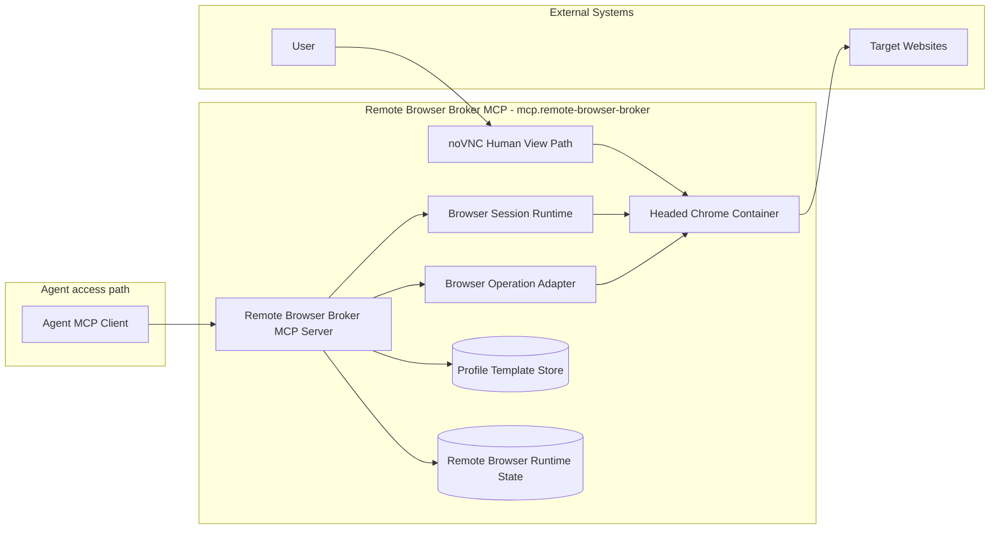
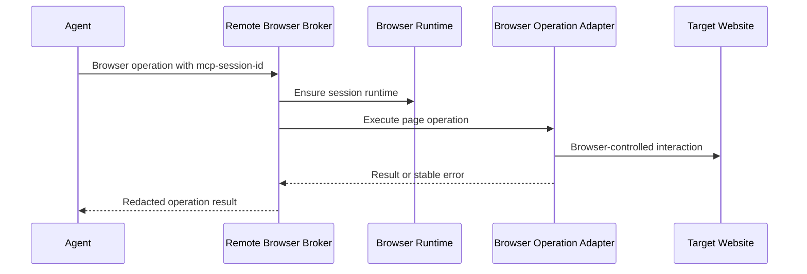
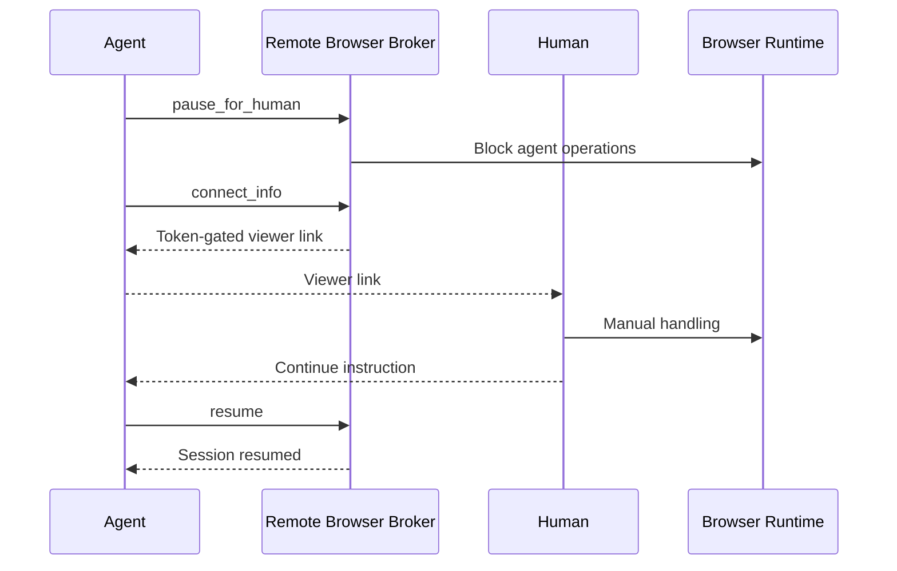
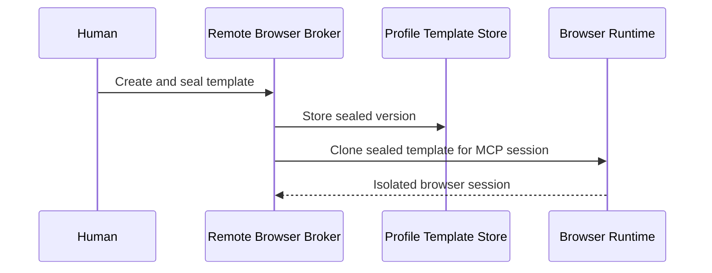

# Remote Browser Broker MCP - Containers

## Contents

1. [Overview](#overview)
2. [Container Diagram](#container-diagram)
3. [Containers](#containers)
4. [Key Interactions](#key-interactions)
5. [Security & Trust](#security--trust)
6. [Assumptions](#assumptions)
7. [Data Stores](#data-stores)
8. [References](#references)

## Overview

Remote Browser Broker MCP (`mcp.remote-browser-broker`) is the tools-layer container for isolated visible browser sessions.
It gives each Agent-owned MCP session one broker-managed browser runtime while preserving human observation and takeover through a separate noVNC path.
It complements platform-native browser and computer-use surfaces rather than replacing them.

At a high level, the broker maps one HTTP or stdio MCP session to one Docker browser runtime and operates pages through internal browser-control adapters.
Sensitive runtime profiles, templates, screenshots, and diagnostics stay under `.tokimon/tools/mcp/remote-browser/`.
The normal product promise is `Agent -> MCP session -> Docker container -> browser`; clients must keep each Agent on its own MCP session.
The local MCP client acts for the user and executes browser and management operations directly.

**Responsibilities**
- Expose browser-session operations through HTTP and stdio MCP.
- Preserve `one MCP session -> one Docker container -> one browser`.
- Coordinate session, profile, and template ownership safely across broker processes.
- Preserve profiles across transport loss and expiry, recover retained ownership with a private task-held token, and stop eligible idle sessions to free active slots.
- Keep normal page operation on the broker automation path through internal browser control.
- Keep noVNC / Browser Use as the human observation and manual takeover path.
- Support human pause/resume, configurable pacing, retained runtime profiles, and sealed profile templates.
- Keep browser profiles, templates, screenshots, logs, and runtime state under `.tokimon/tools/mcp/remote-browser/`.

**Non-responsibilities**
- Do not own browser-surface selection policy.
- Do not share a live browser session across different MCP sessions.
- Do not require routine callers to pass owner ids or browser session ids.
- Do not expose raw CDP through normal session connect info.
- Do not promise CAPTCHA, 2FA, rate-limit, security-confirmation, or universal bot-detection bypass.
- Do not store browser profile templates, cookies, credentials, page content, screenshots, typed text, noVNC tokens, or CDP endpoints in committed files.

## Container Diagram

## Containers

### Remote Browser Broker MCP Server
- **Type:** API Runtime
- **Responsibility:** Provide MCP transport and session routing for isolated browser lifecycle, human takeover, templates, diagnostics, and cleanup.
- **Technology:** `.venv` Python MCP server.
- **Data:** MCP session ids, internal browser session records, pause status, connect-info metadata, lifecycle state, redacted diagnostics, and artifact paths.
- **Key interfaces:**
  - Capability id: `mcp.remote-browser-broker`
  - Default endpoint: `health --json` reports the installation-scoped `broker_url`.
  - Entrypoints:
    - `.venv/bin/python -m tokimon.tools.mcp.remote_browser_broker serve`
    - `.venv/bin/python -m tokimon.tools.mcp.remote_browser_broker serve-http --host 127.0.0.1`
  - MCP tool families:
    - session lifecycle, status, and human takeover.
    - page observation and mutation.
    - session management, templates, and diagnostics.

### Browser Session Runtime
- **Type:** Infrastructure
- **Responsibility:** Run one isolated headed Chrome browser for the current MCP session with broker-owned profile, downloads, CDP, and noVNC paths.
- **Technology:** Docker browser container with Chrome Stable by default and dynamically allocated loopback host ports.
- **Data:** Runtime profile directory, downloads, browser process state, dynamic port allocation, retained-session metadata, and container state.
- **Key interfaces:**
  - MCP session id to browser runtime mapping.
  - Session profile root under `.tokimon/tools/mcp/remote-browser/sessions/`.

### Browser Operation Adapter
- **Type:** Tool Adapter
- **Responsibility:** Execute broker-owned page operations while enforcing pause, tab/stale-ref, and same-origin backend-request rules.
- **Technology:** Broker-owned structured browser control.
- **Data:** Structured element refs, page snapshots, same-origin backend responses, screenshot artifact paths, tab state, and stable error codes.
- **Key interfaces:**
  - Page-operation MCP interface family.
  - Same-origin backend request path for authenticated workflow-owned browser automation.

### Human View Path
- **Type:** Managed Service
- **Responsibility:** Let a human observe or take over the current browser session without making noVNC the agent automation path.
- **Technology:**
  - noVNC human view connection material.
  - Browser Use connection material protected by broker-issued per-session bearer tokens.
- **Data:** Human-view connection metadata, token status, pause state, and SSH tunnel guidance.
- **Key interfaces:**
  - `browser_pause_for_human` and `browser_resume` for human takeover.

### Profile Template Store
- **Type:** Data Store
- **Responsibility:** Store broker-local sealed browser profile templates and clone them into isolated runtime profiles for new MCP sessions.
- **Technology:** Local filesystem state under `.tokimon/tools/mcp/remote-browser/templates/`.
- **Data:** Template profile data, template lifecycle state, environment metadata, and cloneable sealed versions.
- **Key interfaces:**
  - Template create, seal, list, refresh, delete, and clone operations.

### Remote Browser Runtime State
- **Type:** Data Store
- **Responsibility:** Store broker-local session state, retained profiles, screenshots, downloads, diagnostics, cleanup metadata, and retention markers.
- **Technology:** Local filesystem state under `.tokimon/tools/mcp/remote-browser/`.
- **Data:** Session directories, retained runtime profiles, screenshots, profile retention metadata, diagnostics, and cleanup records.
- **Key interfaces:**
  - Session runtime root: `.tokimon/tools/mcp/remote-browser/sessions/`
  - Template runtime root: `.tokimon/tools/mcp/remote-browser/templates/`

## Key Interactions

### Session Ensure and Page Operation
1. The MCP client sends browser operations within the user's task authorization, using a stable `mcp-session-id`.
2. The broker ensures the current MCP session has one running browser runtime.
3. The broker performs page operations through broker-owned structured browser control.
4. The broker returns structured status, refs, artifact paths, or stable error codes without exposing raw CDP by default.

### Human Takeover
1. The agent pauses the session for human handling.
2. The broker blocks page actions while allowing page observation.
3. The agent requests its current session's protected noVNC / Browser Use link and gives it to the human.
4. The agent resumes the session after the human signals intent such as "continue".

### Template-Backed Session
1. A human prepares and seals a broker-local browser profile template.
2. A new MCP session requests that sealed template.
3. The broker clones the sealed profile into a new isolated runtime profile.
4. Live session changes never write back to the sealed template automatically.

### Consumption Patterns

**Primary consumers:** Agent browser tasks, observing humans, and workflows consume browser-session operation and connection surfaces across live-browser work.

**Dependencies consumed:**
  - External Systems provide Docker, headed Chrome, target websites, and optional SSH tunnels.
  - Repository Components provide registry availability for `mcp.remote-browser-broker`.

## Security & Trust

- Local MCP clients act for the user; task authorization belongs to the caller.
- HTTP access is loopback-only and rejects browser-origin requests and non-loopback Host headers.
- Profiles, templates, and artifacts stay in local runtime storage; logs and diagnostics omit secrets and page content.
  Relative runtime-root overrides resolve from the primary worktree; overrides inside linked worktrees are rejected.
- Human-view credentials are requested explicitly and revoked on stop, cleanup, or expiry.
  Pause blocks automatic page actions while allowing observation and human-view access.
- Runtime paths are contained and non-symlink; copied browser content rejects symlinks and special files.
  Docker cleanup verifies exact resource identity and exclusive ownership.
- Live peer-owned state remains owned by its broker process; abandoned state requires reconciliation before reuse or cleanup.
  Capacity reclamation preserves human takeover, template drafts, and retained profiles.
- Browser containers use minimal mounts and separate Docker bridges. Destination filtering and host disk quotas belong to host configuration.
- Protocol inputs and artifacts are bounded; admission stops eligible idle browsers before reporting active-capacity exhaustion.

## Assumptions

- **Assumption:** The broker runs on a Docker-capable host with Chrome Stable or an explicitly permitted fallback for tests.
- **Assumption:** Each Agent client preserves its own `mcp-session-id`; losing that id creates a new isolated browser session.
- **Assumption:** Browser profile templates are local sensitive runtime state prepared by the human and not repository content.
- **Assumption:** Same-host principals with permission to inspect processes, connect to loopback ports, or control Docker are trusted.
- **Assumption:** Deployments that require destination-restricted egress or installation-wide disk quotas enforce those controls outside the broker.
- **Assumption:** The base image is digest-pinned.
  Debian and Chrome packages installed during a rebuild remain repository-time inputs that maintainers must refresh and validate deliberately.
- **Assumption:** The current Google Chrome Stable package path is Linux `amd64`; other architectures require an explicit supported browser-image design.

## Data Stores

- **Owned stores:**
  - `.tokimon/tools/mcp/remote-browser/sessions/`
  - `.tokimon/tools/mcp/remote-browser/templates/`
  - `.tokimon/tools/mcp/remote-browser/`
- **Dependency stores:**
  - Docker runtime state and browser container layers on the broker host.

## References

- L1 Context: `docs/c4/level-1-context/tools-context.md`
