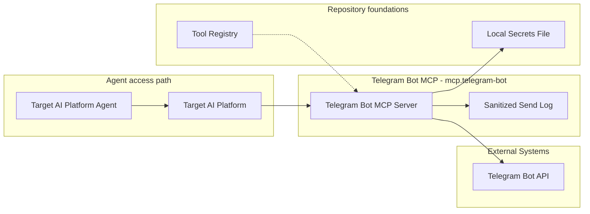
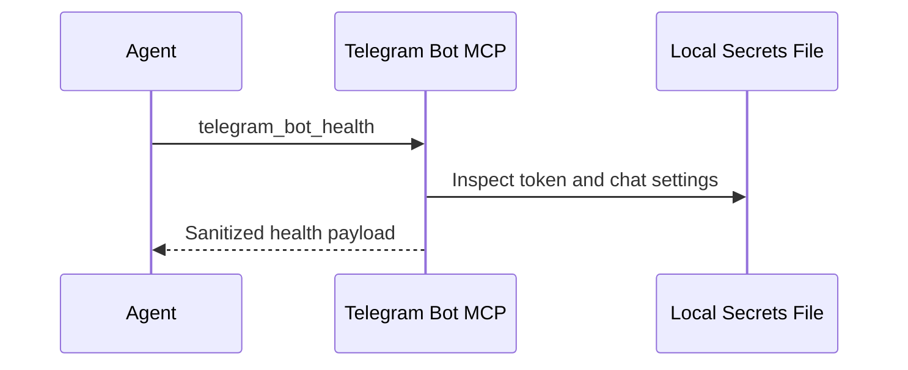
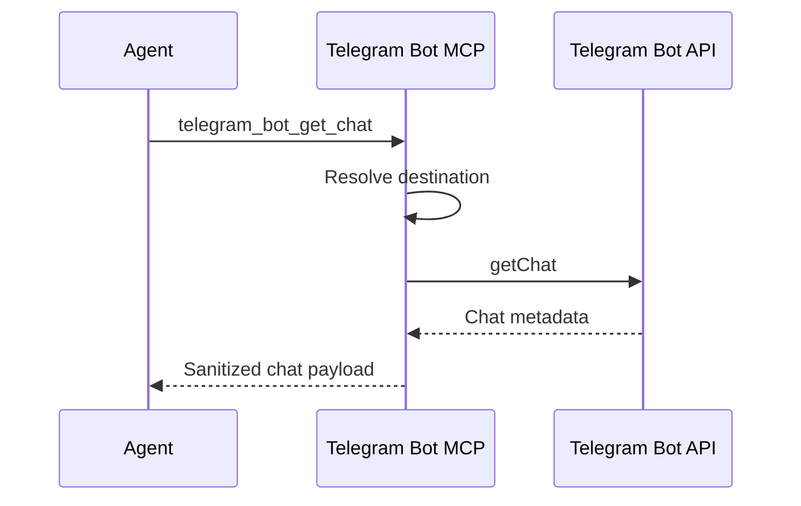
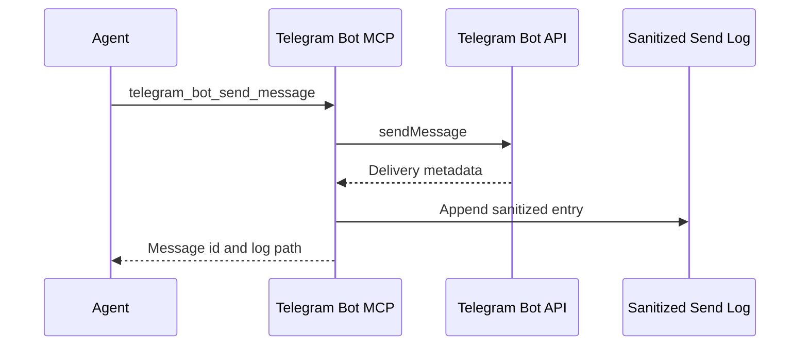
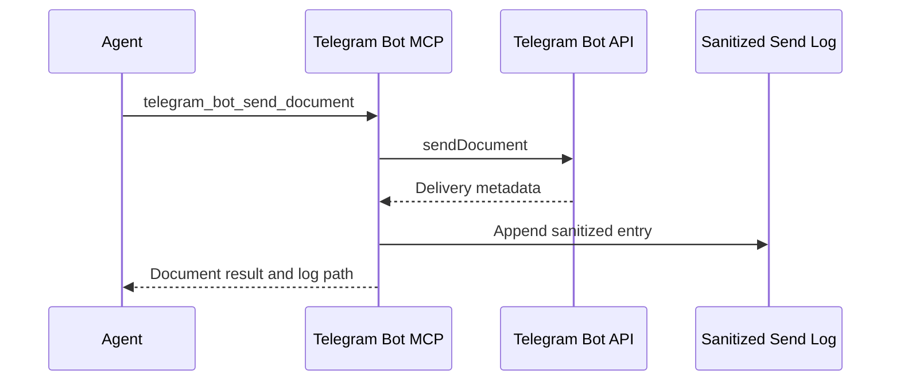
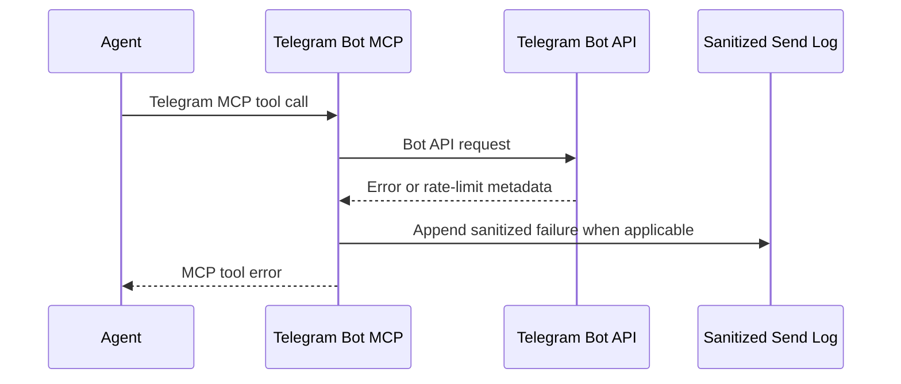

# Telegram Bot MCP - Containers

## Contents

1. [Overview](#overview)
2. [Container Diagram](#container-diagram)
3. [Containers](#containers)
4. [Key Interactions](#key-interactions)
5. [Security & Trust](#security--trust)
6. [Data Stores](#data-stores)
7. [References](#references)

## Overview

Telegram Bot MCP (`mcp.telegram-bot`) is Tokimon's send-only MCP capability for Telegram text messages and document attachments.
It exposes Telegram operations through a stdio MCP server while keeping credentials and sanitized runtime logs under `.tokimon/`.

At a high level, the Telegram Bot MCP server handles send and diagnostic tool calls.
It loads local bot configuration, validates destinations, and sends one text or document payload per tool call.
It appends sanitized send evidence under `.tokimon/tools/mcp/telegram-bot/`.

**Responsibilities**
- Run a stdio MCP server for Telegram health, chat diagnostics, text sends, document sends, and log tailing.
- Load a Telegram bot token from `TELEGRAM_BOT_TOKEN` or `.tokimon/secrets.local.json`.
- Resolve a target chat from explicit tool arguments, configured `allowed_chats`, or `default_chat_id`.
- Send one plain text Telegram message or one document attachment per MCP tool call.
- Write sanitized send logs for operator debugging.
- Surface Telegram API errors, rate-limit hints, and destination problems clearly.

**Non-responsibilities**
- Do not expose a public local send CLI or import surface for adopting repositories.
- Do not persist message bodies, captions, document content, or bot tokens in send logs.
- Do not read Telegram updates or chat history.
- Do not automatically retry sends.
- Do not manage BotFather setup or mutate the secrets file.
- Do not provide Markdown or HTML parse modes in v1.

## Container Diagram

## Containers

### Telegram Bot MCP Server
- **Type:** Tool Runtime
- **Responsibility:** Provide a stdio MCP server for health checks, bot identity, chat metadata validation, plain text sends, document sends, and sanitized log tailing.
- **Technology:**
  - `.venv` Python
  - stdio MCP
  - Telegram Bot API over Python standard-library HTTP
- **Data:** Local token presence, chat ids, outbound text length/hash, Telegram response metadata, MCP response payloads, and sanitized local log entries.
- **Key interfaces:**
  - MCP server command:
    - `.venv/bin/python -m tokimon.tools.mcp.telegram_bot serve`
  - Diagnostic command:
    - `.venv/bin/python -m tokimon.tools.mcp.telegram_bot health --json`
  - Capability identifiers:
    - `mcp.telegram-bot`
    - `tokimon-telegram-bot`
  - MCP tool families:
    - health and bot identity.
    - chat validation.
    - text and document sends.
    - sanitized log tailing.

### Local Secrets File
- **Type:** Data Store
- **Responsibility:** Hold the user-managed bot token and optional local chat ids outside git.
- **Technology:** JSON file at `.tokimon/secrets.local.json`.
- **Data:** `telegram.bot_token`, optional `telegram.default_chat_id`, and optional `telegram.allowed_chats`.
- **Key interfaces:**
  - Read-only from this MCP server.
  - File mode warning when the file is not `0600` on POSIX hosts.

### Telegram Bot API
- **Type:** External System
- **Responsibility:** Accept Bot API calls for bot identity, chat metadata, and message delivery.
- **Technology:** HTTPS API at `api.telegram.org`.
- **Data:** Bot-owned API responses, chat metadata, and delivered messages.
- **Key interfaces:**
  - Bot API methods:
    - `getMe`
    - `getChat`
    - `sendMessage`
    - `sendDocument`

### Sanitized Send Log
- **Type:** Data Store
- **Responsibility:** Give operators enough evidence to debug missing or unexpected sends without storing tokens or full message bodies.
- **Technology:** JSONL file at `.tokimon/tools/mcp/telegram-bot/sends.jsonl`.
- **Data:** Sanitized send evidence for successful and failed real send attempts.
- **Key interfaces:**
  - Send-log writes:
    - append on real send attempts
  - MCP tool family:
    - sanitized log tailing.

## Key Interactions

### MCP Health Flow
1. A target AI platform starts `.venv/bin/python -m tokimon.tools.mcp.telegram_bot serve`.
2. The agent calls `telegram_bot_health`.
3. The server reports sanitized local configuration status without requiring a live Telegram API call by default.

### Chat Validation Flow
1. The agent calls `telegram_bot_get_chat`.
2. The server resolves the target chat id.
3. The server calls Telegram `getChat`.
4. The MCP response reports chat id, type, title, and related metadata without reading messages.

### Send Flow
1. The agent calls `telegram_bot_send_message`.
2. The server validates text and resolves exactly one target destination or uses `default_chat_id`.
3. For dry runs, the server returns destination, length, and hash without calling Telegram or writing a send log.
4. For real sends, the server makes one `sendMessage` call and appends sanitized send evidence.

### Document Send Flow
1. The agent calls `telegram_bot_send_document`.
2. The server resolves exactly one target destination or uses `default_chat_id`.
3. The server validates the local document path, optional caption, and configured document-root boundary.
4. For dry runs, the server returns filename, byte count, document hash, and caption hash without sending or writing a send log.
5. For real sends, the server makes one `sendDocument` call and appends sanitized send evidence.

### Failure Handling Flow
1. Config, destination, network, Telegram API, or rate-limit failure occurs.
2. The server returns an MCP tool error with sanitized diagnostics.
3. Failed real send attempts are logged without tokens or message bodies.
4. If Telegram provides `retry_after`, the server reports it but does not retry automatically.

### Consumption Patterns

**Primary consumers:** Target AI platform agents, workflows, and local operators consume Telegram MCP tools, readiness, health, and log-tail diagnostics.

**Dependencies consumed:** External Systems provide the Telegram Bot API; Repository Components provide registry availability for `mcp.telegram-bot`.

## Security & Trust

- Bot tokens and configured chat ids remain in `TELEGRAM_BOT_TOKEN` or `.tokimon/secrets.local.json`; send logs exclude them.
- Send logs store hashes, counts, ids, filenames, and sanitized error details, not message bodies, captions, tokens, or document content.
- The MCP server is send-only and does not read Telegram updates, message bodies, or chat history.
- Document sends are limited to Tokimon repository-owned, Tokimon runtime-owned, or configured adopter-owned paths.

## Data Stores

- **Owned stores:**
  - `.tokimon/tools/mcp/telegram-bot/sends.jsonl`

- **Dependency stores:**
  - `.tokimon/secrets.local.json`

## References

- L1 Context: `docs/c4/level-1-context/tools-context.md`
- Tool Registry: `docs/c4/level-2-containers/tools/tool-registry.md`
