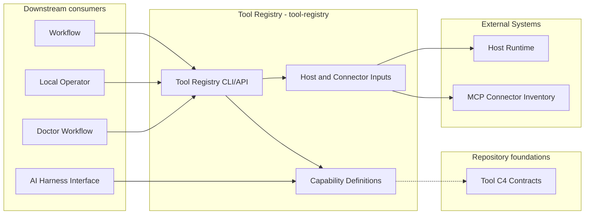
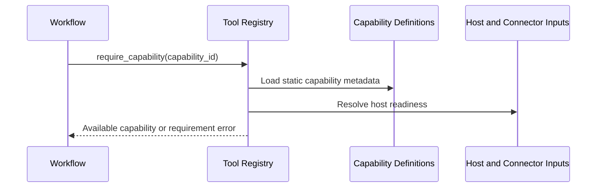
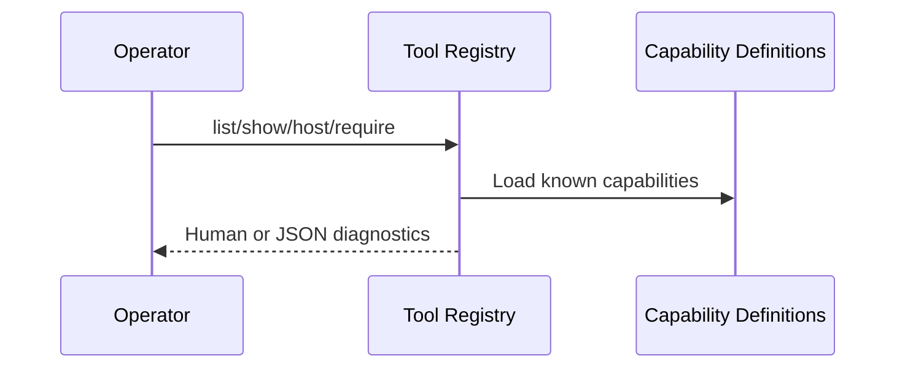

# Tool Registry - Containers

## Contents

1. [Overview](#overview)
2. [Container Diagram](#container-diagram)
3. [Containers](#containers)
4. [Key Interactions](#key-interactions)
5. [Security & Trust](#security--trust)
6. [Data Stores](#data-stores)
7. [References](#references)

## Overview

Tool Registry (`tool-registry`) is the repository-facing discovery, readiness, and requirement boundary over the shared tools-layer capability catalog.
The same static catalog feeds registry diagnostics, workflow requirement checks, and AI Harness Interface packaging so capability identity and MCP route metadata have one owner.

At a high level, the Tool Registry CLI/API reads Host and Connector Inputs.
Capability Definitions supply static metadata, and readiness checks derive the current status.
Operators, agents, and Doctor consume readiness diagnostics; workflows use the requirement API; AI Harness Interface consumes the static catalog's fixed package membership.
The registry never launches services or mutates runtime state.

**Responsibilities**
- Report the current host profile and known tools-layer capabilities.
- Distinguish available and unavailable capabilities.
- Let workflows fail before domain work starts when a required capability is unknown or unavailable.
- Read connector-backed MCP capability inventory from local runtime configuration when present.
- Keep capability identity and MCP route metadata in one static catalog shared by Registry readiness and AI Harness Interface packaging.

**Non-responsibilities**
- Do not start tools, browser sessions, MCP servers, or workflows.
- Do not own credentials, browser session state, Telegram tokens, or workflow artifacts.
- Do not replace the C4 contracts for individual tool capabilities.
- Do not persist registry state.

## Container Diagram

## Containers

### Tool Registry CLI/API
- **Type:** API Runtime
- **Responsibility:** Provide host, list, show, and require operations for tools-layer capabilities.
- **Technology:** `.venv` Python CLI and API.
- **Data:** Host profile, capability ids, current status values, registry diagnostics, and health-check metadata.
- **Key interfaces:**
  - Operator entrypoint:
    - `.venv/bin/python -m tokimon.tools.registry`
  - Command families:
    - `host [--json]`
    - `list [--json]`
    - `show <capability_id> [--json]`
    - `require <capability_id> [--json]`
  - Python API:
    - `require_capability(capability_id)`

### Capability Definitions
- **Type:** Infrastructure
- **Responsibility:** Declare known tools-layer capabilities, package routing, readiness requirements, command metadata, and health-check metadata.
- **Technology:** Static Python catalog resolved against local host and connector facts.
- **Data:** Capability identity, kind, package route, readiness requirements, command surfaces, health checks, and C4 references.
- **Key interfaces:**
  - Declaration family:
    - shared tools-layer capability metadata consumed directly by Registry and AI Harness Interface.
  - Update owner:
    - shared tools-layer catalog.

### Host and Connector Inputs
- **Type:** Data Store
- **Responsibility:** Provide read-only local runtime inputs used to resolve host profile and connector-backed MCP availability.
- **Technology:**
  - Environment variables.
  - Optional JSON under `.tokimon/tools/mcp/connectors.json`.
- **Data:** Host facts, local connector inventory, local prerequisite presence, MCP endpoint metadata, and configured connector statuses.
- **Key interfaces:**
  - Connector inputs:
    - `TOKIMON_MCP_CONNECTORS_JSON`
    - `.tokimon/tools/mcp/connectors.json`
  - Secret-presence checks:
    - inspect whether required local secrets are configured without printing values.

## Key Interactions

### Capability Requirement
1. A workflow declares a required tools-layer capability id.
2. Before domain work starts, it calls `tokimon.tools.registry.require_capability(...)` or the `require` command.
3. The registry resolves the shared capability definition against Host and Connector Inputs.
4. The workflow receives an available capability or an actionable requirement error and stops before domain work.

### Operator Diagnostics
1. A local operator runs `host`, `list`, `show <capability_id>`, or `require <capability_id>`.
2. The registry renders current host and capability metadata without launching services.
3. The operator uses the diagnostic to choose setup, fallback, or workflow execution.

### Consumption Patterns

**Primary consumers:** Workflows consume the requirement API; operators and agents consume CLI/API readiness surfaces; Doctor consumes the capability map; AI Harness Interface consumes package membership and route metadata.

**Dependencies consumed:** External Systems provide host prerequisites; Repository Components provide tool contracts, capability declarations, package routes, and local connector inventory.

## Security & Trust

- The registry may inspect token presence or connector metadata, but it must not print token values, credentials, cookies, browser session state, or MCP secrets.
- Registry checks are read-only and must not launch tools, browser sessions, MCP servers, or external health calls.
- Connector inventory is local runtime state under `.tokimon/` or environment variables and must not contain credentials.

## Data Stores

- **Owned stores:**
  - None.
- **Dependency stores:**
  - `.tokimon/tools/mcp/connectors.json`

## References

- L1 Context: `docs/c4/level-1-context/tools-context.md`
- L2 Container: `docs/c4/level-2-containers/tools/mcp/telegram-bot.md`
- L2 Container: `docs/c4/level-2-containers/tools/mcp/ai-debate.md`
- L2 Container: `docs/c4/level-2-containers/tools/mcp/remote-browser-broker.md`
- L2 Container: `docs/c4/level-2-containers/tools/mcp/remote-agent-broker.md`
