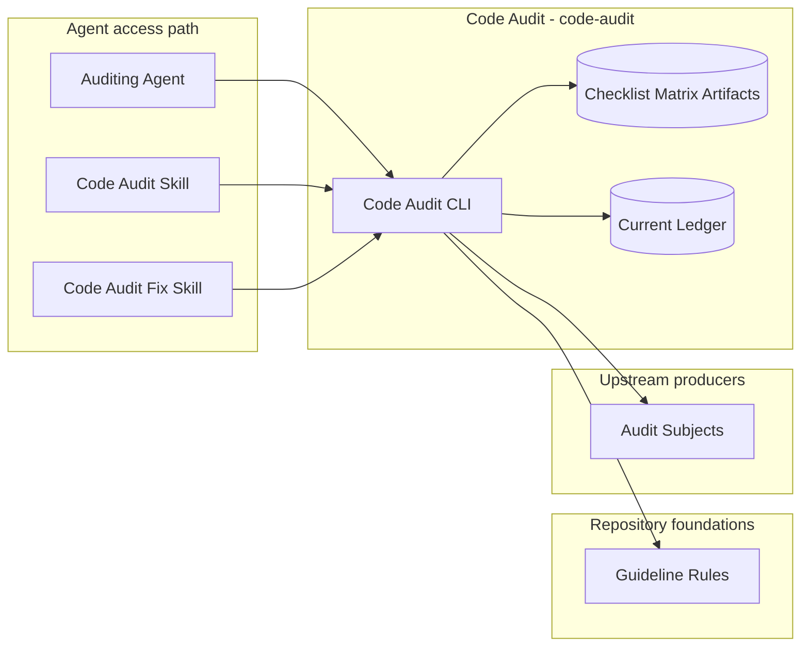
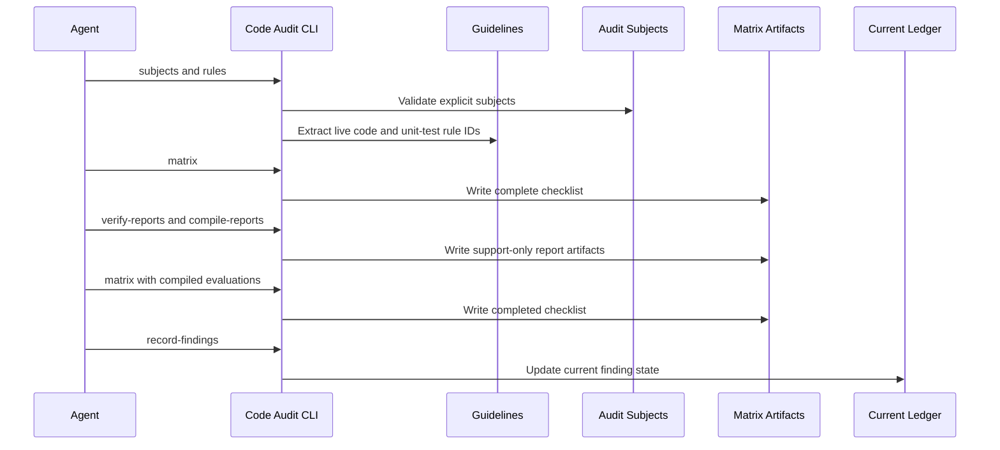
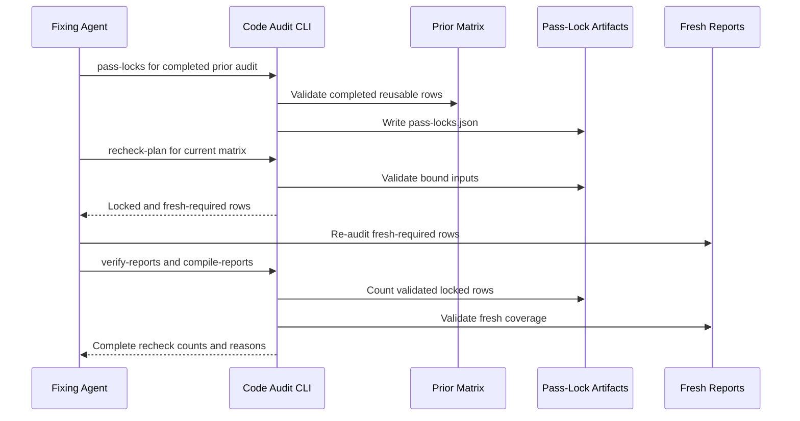

# Code Audit - Containers

## Contents

1. [Overview](#overview)
2. [Container Diagram](#container-diagram)
3. [Containers](#containers)
4. [Key Interactions](#key-interactions)
5. [Security & Trust](#security--trust)
6. [Data Stores](#data-stores)
7. [References](#references)

## Overview

The code audit workflow (`code-audit`) is Tokimon's repeatable local process for implementation audits.
It applies code and unit-test guideline rule IDs to explicit audit subjects, verifies structured row reports, validates pass-lock recheck plans, and records the accepted current disposition of each audited row.

At a high level, the workflow turns guideline rules and explicit subjects into complete report-backed audit artifacts.
It preserves traceability through support-only evaluations and an auditor-accepted ledger.
Human or agent judgment still owns semantic audit decisions.

**Responsibilities**
- Extract live audit rule IDs from the code and unit-test guidelines.
- Validate explicit audit subjects supplied by the auditor.
- Select the audited project and isolate its ledger while binding matrices and reusable results to the checkout.
- Freeze reviewed inputs and validate preserved subagent results before accepting fresh coverage or reuse.
- Write `rules x audit subjects` checklist matrices.
- Write support-only pass-lock artifacts for completed `pass` and `not_applicable` rows.
- Produce lock-aware recheck plans that require fresh reports for changed, failed, or human-review rows.
- Verify exactly one structured report for each fresh-required row and combine it with validated locked coverage.
- Compile structured reports into support-only matrix evaluations.
- Validate auditor-accepted evaluation provenance before recording durable row dispositions.
- Open current findings from `fail` and `needs_human_review` rows, and close prior findings for the same scope/rule/subject row when a later accepted row is `pass` or `not_applicable`.
- Store compact current and resolved finding state under the local workflow runtime root.
- Preserve full per-run checklist, report-support, and accepted ledger artifacts for traceability.

**Non-responsibilities**
- Do not infer audit subjects by scanning the repository.
- Do not make semantic audit judgments in Python.
- Do not edit audited code or tests.
- Do not replace guideline documents as the source of audit truth.
- Do not store Pair transcripts, ChatGPT conversations, product payloads, or secrets.

## Container Diagram

## Containers

### Code Audit CLI
- **Type:** CLI Runtime
- **Responsibility:** Provide rule extraction, subject validation, checklist matrix, pass-lock, recheck-plan, structured report verification, report-support compilation, accepted row-disposition recording, and ledger health summary commands.
- **Technology:** `.venv` Python CLI.
- **Data:** Guideline rules, audit subjects, checklist rows, structured reports, evaluation records, compact ledger entries, and artifact paths.
- **Key interfaces:**
  - Operator entrypoint:
    - `.venv/bin/python -m tokimon.workflow.code_audit`
  - Command families:
    - Contract and rule discovery.
    - Subject validation and matrix creation.
    - Pass-lock creation and recheck planning.
    - Report coverage, support compilation, and accepted finding recording.
    - Ledger summary.
  - Default local artifact root: `.tokimon/workflow/code-audit/projects/<project-id>/`
  - Current ledger: `.tokimon/workflow/code-audit/projects/<project-id>/ledger/current.json`

### Guideline Rule Sources
- **Type:** Data Store
- **Responsibility:** Own live code-audit rule IDs and descriptions.
- **Technology:** Markdown rule bullets in `docs/guidelines/code-guidelines.md` and `docs/guidelines/unit-testing-guidelines.md`.
- **Data:** Rule IDs, descriptions, source paths, source lines, and rule hashes.
- **Key interfaces:**
  - Guideline sources:
    - `docs/guidelines/code-guidelines.md`
    - `docs/guidelines/unit-testing-guidelines.md`

### Audit Subjects
- **Type:** Import Adapter
- **Responsibility:** Bound the implementation surfaces under audit.
- **Technology:** Caller-supplied JSON subject files.
- **Data:** Audit subject id, title, at least one boundary field, implementation paths, test paths, owning specs, verification commands, dependency edges, and notes.
- **Key interfaces:**
  - Subject input command:
    - `subjects --subjects-from <subjects.json>`

### Current Ledger
- **Type:** Data Store
- **Responsibility:** Store latest state for each auditor-accepted finding fingerprint, including explicit `fixed` and `stale` closure states.
- **Technology:** JSON under `.tokimon/workflow/code-audit/projects/<project-id>/ledger/current.json`.
- **Data:** Fingerprint, scope id, rule id, audit subject id, normalized subject, open/resolved status, evidence, verification, review prompt, run references, rule hash, and resolution metadata.
- **Key interfaces:**
  - Read by `ledger-summary`
  - Written by `record-findings` after accepted evaluations exist.

### Code Audit Skills
- **Type:** Agent Operating Guide Collection
- **Responsibility:** Guide evidence-first implementation audits and remediation loops while using workflow-backed rule, matrix, pass-lock, recheck-plan, and ledger support.
- **Technology:** Skill entrypoints (`skills/code-audit/skill.md`, `skills/code-audit-fix/skill.md`).
- **Data:** Rule IDs, subject definitions, matrix artifacts, structured reports, pass-locks, recheck plans, finding evidence, fixes, verification results, and final audit disposition.
- **Key interfaces:**
  - `code-audit` activates read-only fresh audit execution.
  - `code-audit-fix` activates bounded fix, verify, and targeted re-audit execution.
  - Both call command families for subject, matrix, report, and ledger support.
  - `code-audit-fix` additionally calls pass-lock and recheck-plan support during target rechecks.
  - Reports matrix paths, report coverage counts, support artifact paths, accepted finding dispositions, and recheck lock coverage when applicable.

## Key Interactions

### Fresh Matrix-Backed Audit

1. The agent identifies scope, audit subjects, owner docs, and verification commands.
2. The workflow validates caller-provided audit subjects.
3. The workflow extracts live rule IDs from the guideline sources.
4. The agent reads code, tests, and owner docs, then evaluates each subject/rule pair.
5. Assigned subagents return one structured report for each subject/rule row, with preserved result references.
6. The workflow verifies fresh report coverage and matrix provenance, then compiles support-only row evaluation artifacts in one validated report traversal.
7. The workflow writes a complete checklist matrix and summary artifacts from compiled evaluations.
8. The agent decides accepted finding dispositions.
9. The workflow records every accepted row disposition: failed and human-review rows open findings, while pass and not-applicable rows close prior open findings for that exact scope/rule/subject row.
10. The agent reports accepted findings from evidence-backed rows.

### Lock-Aware Remediation Recheck

1. `code-audit-fix` starts from a complete prior target audit and applies a bounded fix.
2. The workflow writes pass-locks for completed prior `pass` and `not_applicable` rows.
3. The workflow validates prior pass-locks against the current matrix and bound input hashes.
4. The agent re-audits only rows that are unlocked, previously failed, need human review, or have changed lock inputs.
5. The workflow verifies fresh reports plus validated unchanged pass-lock coverage and compiles support-only row evaluations.
6. The agent reports fresh report counts, locked row counts, unlocked row counts, lock artifact paths, and each unlocked-row reason.

### Consumption Patterns

**Primary consumers:**
- `code-audit` consumes subject validation, rule extraction, checklist matrices, report verification, report-support compilation, and accepted finding-recording commands during read-only implementation audits.
- `code-audit-fix` consumes the same commands plus pass-lock and recheck-plan support during bounded remediation loops.

**Dependencies consumed:** Repository Components provide the code and unit-test guidelines that own the workflow's audit rule IDs.

## Security & Trust

- The workflow is local-only and does not call external services or read browser sessions, cookies, provider tokens, API keys, or external auth material.
- Audit artifacts live under `.tokimon/workflow/code-audit/projects/<project-id>/` and must remain local-only.
- Subject input files must point at existing repository paths so audits do not silently evaluate imaginary surfaces.

## Data Stores

- **Owned stores:**
  - `.tokimon/workflow/code-audit/projects/<project-id>/runs/<run-id>/`
  - `.tokimon/workflow/code-audit/projects/<project-id>/ledger/current.json`
- **Dependency stores:**
  - `docs/guidelines/code-guidelines.md`
  - `docs/guidelines/unit-testing-guidelines.md`
  - Caller-supplied subject and evaluation JSON

## References

- L1 Context: `docs/c4/level-1-context/workflow-context.md`
- Guidelines: `docs/guidelines/code-guidelines.md`
- Guidelines: `docs/guidelines/unit-testing-guidelines.md`
