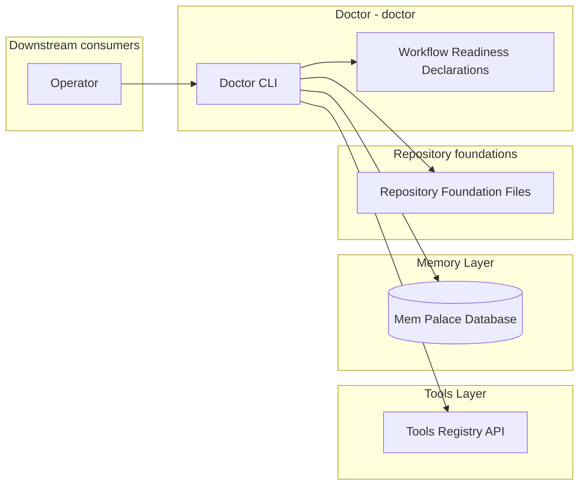
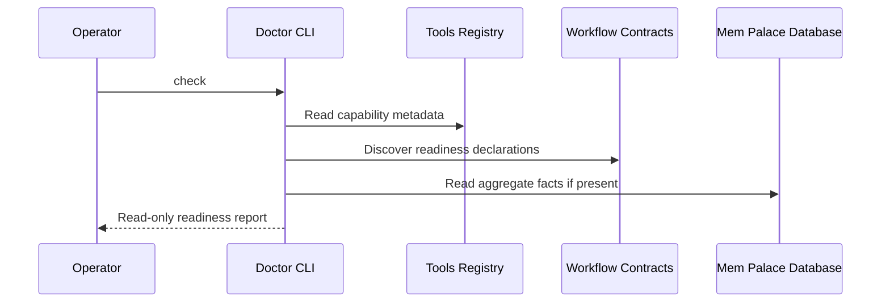

# Doctor - Containers

## Contents

1. [Overview](#overview)
2. [Container Diagram](#container-diagram)
3. [Containers](#containers)
4. [Key Interactions](#key-interactions)
5. [Security & Trust](#security--trust)
6. [Data Stores](#data-stores)
7. [References](#references)

## Overview

The doctor workflow (`doctor`) is Tokimon's read-only readiness report.
It gives an operator one local list of current memory usage, tools-layer availability, and workflow readiness so they can see which capabilities can run and which are blocked on the host.

Doctor is intentionally diagnostic only.
It does not repair, install, migrate, run tests, launch services, or call external provider health checks.

At a high level, the Doctor CLI reads local repository facts and capability metadata, then renders one readiness report.
It reports readiness without mutating the repository or local runtime state.

**Responsibilities**
- Emit a Mem Palace usage brief, including memory counts, schema version, relationship counts, top scopes, and top rooms.
- List every tools-registry capability with ready or blocked readiness.
- Report MCP capability availability from tools-registry metadata.
- List Tokimon workflows with ready, partial, or blocked readiness by aggregating workflow-owned machine-readable readiness declarations.
- Keep low-probability repository structure, `.tokimon/` ignore policy, and `.venv` checks as foundation diagnostics.

**Non-responsibilities**
- Do not mutate repository files or local runtime state.
- Do not run workflow, tool, or memory repair commands.
- Do not run the test suite.
- Do not install Python packages, CLIs, services, MCP connectors, or browser runtimes.
- Do not treat host-specific unavailable tool or workflow capabilities as command failures.

## Container Diagram

## Containers

### Doctor CLI
- **Type:** CLI Runtime
- **Responsibility:** Run cheap read-only readiness checks and render human or JSON output.
- **Technology:** `.venv` Python CLI.
- **Data:** Memory usage facts, tools-registry metadata, workflow readiness reasons, repository path facts, Python path facts, and Mem Palace read-only schema facts.
- **Key interfaces:**
  - Operator entrypoint:
    - `.venv/bin/python -m tokimon.workflow.doctor`
  - Command families:
    - readiness reporting.
    - contract rendering.
  - Runtime surfaces:
    - live Tokimon repository root
    - `.tokimon/workflow/doctor/`

### Tools Registry API
- **Type:** API Runtime
- **Responsibility:** Provide host profile and tool capability metadata for doctor reporting.
- **Technology:** Tool Registry Python API.
- **Data:** Host profile, capability ids, capability status values, and health-check command strings.
- **Key interfaces:**
  - Python APIs:
    - `detect_host_profile(...)`
    - `capability_map(...)`

### Workflow Readiness Declarations
- **Type:** Infrastructure
- **Responsibility:** Let each workflow declare primary and fallback runnable modes, required tools, alternative tool groups, memory requirements, and externally inspected Agent connector needs.
- **Technology:** Workflow-owned machine-readable contract declarations.
- **Data:** Workflow id, status, entrypoint, modes, tool capability ids, Agent connector capability ids, and memory requirements.
- **Key interfaces:**
  - Declaration surface:
    - readiness metadata exposed by each workflow contract.

Doctor reads workflow-owned readiness declarations and summarizes each workflow as ready, partial, or blocked.
The workflow contract JSON owns the exact declaration fields, mode roles, and status catalog.

### Mem Palace Database
- **Type:** Data Store
- **Responsibility:** Store local durable memory rows and schema metadata.
- **Technology:** SQLite under `.tokimon/memory/`.
- **Data:** Schema version and aggregate row counts.
- **Key interfaces:**
  - Read-only SQLite connection opened by doctor when the database exists

## Key Interactions

### Readiness Check
1. The operator runs `.venv/bin/python -m tokimon.workflow.doctor`.
2. Doctor reads repository foundation facts, optional Mem Palace facts, tools-registry metadata, and workflow readiness declarations.
3. Doctor renders a human or JSON readiness report without mutating local state.

### Consumption Patterns

**Primary consumers:** Operators and agents consume the readiness report to decide which Tokimon capabilities can run on the current host.

**Dependencies consumed:** Repository Components provide Memory Layer aggregate facts and workflow-owned readiness declarations; Agent Interfaces provide Tools Layer registry metadata.

## Security & Trust

- Doctor is read-only and must not repair, install, migrate, launch services, run tests, or mutate local runtime state.
- Doctor reads no credentials, cookies, browser sessions, provider tokens, or API keys.
- Host-specific blocked or unavailable tool/workflow readiness should render as readiness status, not command failure unless a foundation check fails.

## Data Stores

- **Owned stores:**
  - None.
- **Dependency stores:**
  - `.tokimon/memory/memory.db`

## References

- L1 Context: `docs/c4/level-1-context/workflow-context.md`
- Tool Registry: `docs/c4/level-2-containers/tools/tool-registry.md`
- Mem Palace: `docs/c4/level-2-containers/memory/mem-palace.md`
