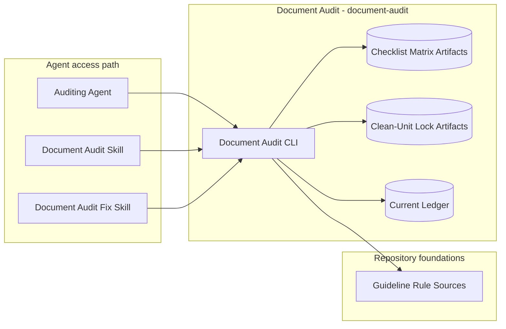
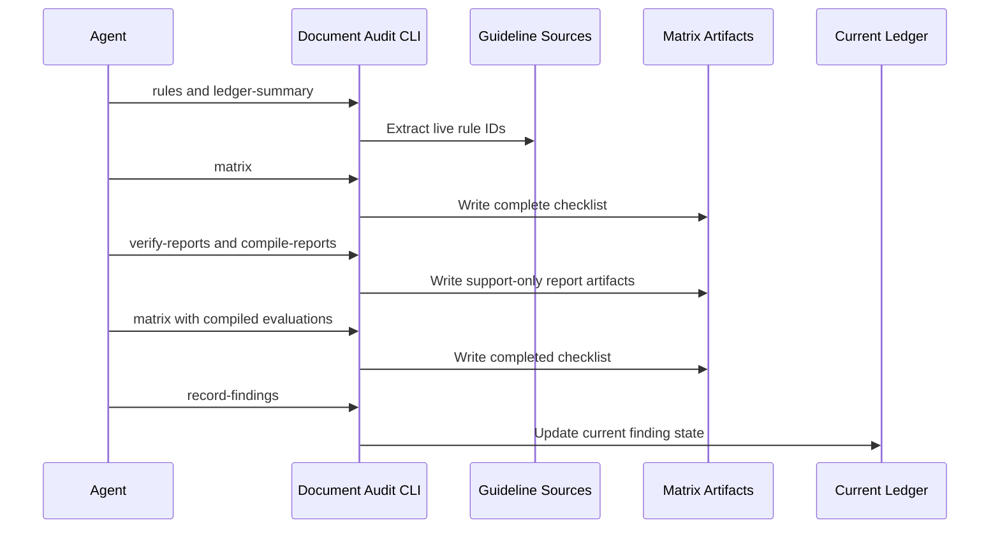
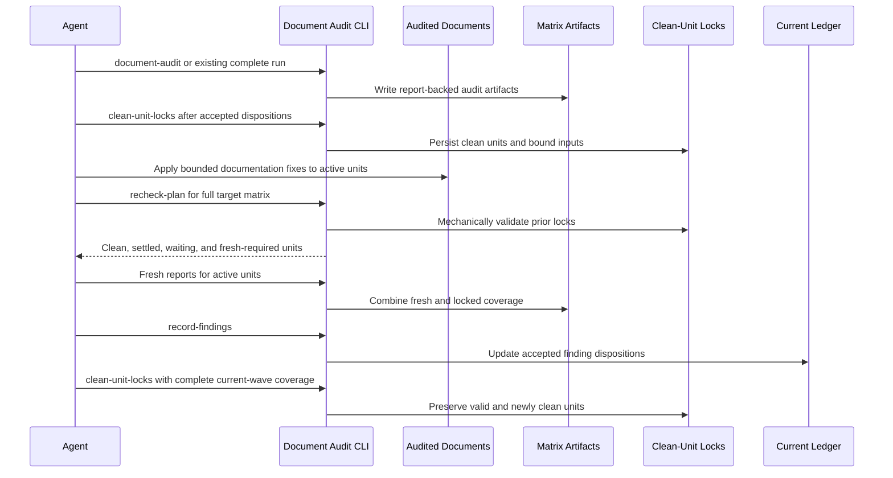

# Document Audit - Containers

## Contents

1. [Overview](#overview)
2. [Container Diagram](#container-diagram)
3. [Containers](#containers)
4. [Key Interactions](#key-interactions)
5. [Security & Trust](#security--trust)
6. [Data Stores](#data-stores)
7. [References](#references)

## Overview

The document audit workflow (`document-audit`) is Tokimon's repeatable local process for documentation audits.
It loads live guideline rule IDs, writes full checklist matrices, verifies structured row reports, and maintains a compact current findings ledger so audits can be rerun without losing prior disposition context.
Remediation rechecks persist mechanically validated clean-unit locks so unchanged units do not need another semantic audit.
Audits select the task repository explicitly and keep project-isolated runtime records in Tokimon, preserving both input versions and actual reviewer sources.

At a high level, the workflow turns selected guideline rules and scoped documents into complete report-backed audit artifacts.
It preserves traceability through support-only evaluations and auditor-accepted ledger updates.
Human or agent judgment still owns semantic audit decisions.

**Responsibilities**
- Extract live audit rule IDs from the general and C4-specific document guidelines.
- Write `rules x documents` checklist matrices for scoped audits.
- Persist audit-unit definitions and support-only state for completed clean and settled units.
- Produce recheck plans that require fresh reports only for active or invalidated units.
- Verify current-wave coverage from fresh structured reports plus validated clean or settled unit state, while excluding waiting rows from final completion.
- Compile structured reports into support-only matrix evaluations.
- Validate auditor-accepted findings against selected rule sources.
- Store compact current finding state under the local workflow runtime root.
- Preserve full per-run checklist, report-support, and accepted ledger artifacts for traceability.

**Non-responsibilities**
- Do not make semantic audit judgments in Python.
- Do not edit audited documents.
- Do not replace the guideline documents as the source of audit truth.
- Do not store Pair transcripts, ChatGPT conversations, product payloads, or secrets.

## Container Diagram

## Containers

### Document Audit CLI
- **Type:** CLI Runtime
- **Responsibility:** Provide rule extraction, audit-unit and checklist matrix creation, clean-unit lock and recheck planning, structured report verification, report-support compilation, ledger health summary, and accepted finding-recording commands.
- **Technology:** `.venv` Python CLI.
- **Data:** Guideline rules, audit units, checklist rows, structured reports, clean-unit locks, recheck plans, finding records, compact ledger entries, and artifact paths.
- **Key interfaces:**
  - Operator entrypoint:
    - `.venv/bin/python -m tokimon.workflow.document_audit`
  - Command families:
    - Contract and rule discovery.
    - Audit-unit and matrix creation.
    - Clean-unit lock creation and recheck planning.
    - Report coverage, including validated locked coverage during remediation rechecks.
    - Report-support compilation and ledger summary.
    - Accepted finding recording.
  - Default local artifact root: `.tokimon/workflow/document-audit/projects/<project-id>/`
  - Current ledger: `.tokimon/workflow/document-audit/projects/<project-id>/ledger/current.json`

### Guideline Rule Sources
- **Type:** Data Store
- **Responsibility:** Own live audit rule IDs and descriptions.
- **Technology:** Markdown rule bullets in `docs/guidelines/document-guidelines.md` and `docs/guidelines/c4-document-guidelines.md`.
- **Data:** Rule IDs, descriptions, source paths, source lines, and rule hashes.
- **Key interfaces:**
  - General document audits use `docs/guidelines/document-guidelines.md`.
  - C4 audits also use `docs/guidelines/c4-document-guidelines.md`.

### Current Ledger
- **Type:** Data Store
- **Responsibility:** Store latest state for each auditor-accepted finding fingerprint and expose read-only health signals for entries whose document path no longer exists.
- **Technology:** JSON under `.tokimon/workflow/document-audit/projects/<project-id>/ledger/current.json`.
- **Data:** Fingerprint, scope id, rule id, file path, normalized subject, severity, status, run references, resolution, and optional recommended action.
- **Key interfaces:**
  - Read by `ledger-summary`
  - Written by `record-findings` after accepted findings exist.

### Document Audit Skills
- **Type:** Agent Operating Guide Collection
- **Responsibility:** Guide read-only documentation audits and bounded documentation remediation loops while preserving human/agent judgment and Tokimon tracked-doc scope boundaries.
- **Technology:** Skill entrypoints (`skills/document-audit/skill.md`, `skills/document-audit-fix/skill.md`).
- **Data:** Rule IDs, audit-unit definitions, matrix artifacts, structured reports, clean-unit locks, recheck plans, finding evidence, documentation fixes, verification results, and final audit disposition.
- **Key interfaces:**
  - `document-audit` activates read-only documentation audit execution.
  - `document-audit-fix` activates bounded documentation fix, verify, and fresh re-audit execution.
  - Both call command families for rule, audit-unit, matrix, report, and ledger support.
  - `document-audit-fix` additionally calls clean-unit lock and recheck-plan support.
  - Reports matrix paths, report coverage counts, support artifact paths, verification results, and accepted finding dispositions.

## Key Interactions

### Matrix-Backed Audit

1. The agent identifies scope, document set, and rule sources.
2. The workflow extracts live rule IDs from selected guideline sources.
3. The workflow summarizes existing current-ledger state for the audit scope.
4. The agent reads the scoped documents and evaluates each document/rule pair.
5. Assigned subagents review documents or coherent groups and return one structured result for each document/rule row.
6. The workflow verifies report coverage and compiles reports into support-only row evaluation artifacts.
7. The workflow writes a complete checklist matrix and summary artifacts from compiled evaluations.
8. The agent decides accepted finding dispositions, including known findings that remain open, fixed, deferred, rejected, blocked, or stale.
9. The workflow records accepted findings into the current ledger.

### Documentation Remediation Loop

Clean-unit locks and terminal-disposition states are workflow support artifacts used only for remediation scheduling; they are not audit authority.

1. `document-audit-fix` starts from a complete document-audit run or runs a fresh audit for the target, treating each document or coherent dependency group as an audit unit.
2. After accepted finding dispositions are recorded, the workflow persists a unit as clean when all rows are `pass` or `not_applicable`, or as settled when every failed finding has a matching `deferred`, `rejected`, or `blocked` ledger disposition.
3. The agent applies bounded documentation edits for evidence-backed findings and explicit user decisions.
4. The agent runs relevant verification for the changed documents.
5. The workflow creates a recheck plan for the full target matrix by validating prior states against the matrix snapshot, unit content, applicable rule rows, declared bound inputs, source reports, and current ledger dispositions.
6. The agent reruns document-audit with fresh reports only for units marked active. A dependent unit waits while an upstream unit is active, then becomes active once after the upstream content is stable.
7. The workflow combines fresh reports with validated clean and settled coverage, then the agent records accepted finding dispositions and refreshes scheduling state.
8. An invalidated unit returns to the active queue without discarding unrelated valid states. The loop finishes only when no unit is active or waiting.

### Consumption Patterns

**Primary consumers:**
- `document-audit` consumes rule extraction, ledger summaries, checklist matrices, report verification, report-support compilation, and accepted finding-recording commands during read-only documentation audits.
- `document-audit-fix` consumes the same commands plus clean-unit lock and recheck-plan support during bounded documentation fix, verification, and targeted fresh re-audit loops.

**Dependencies consumed:**
- **Repository Components:** Specification Documents provide document and C4 guideline rules.

## Security & Trust

- The workflow is local-only and does not call external services or read browser sessions, cookies, provider tokens, API keys, or external auth material.
- Audit artifacts live under `.tokimon/workflow/document-audit/` and must remain local-only.
- Prompt or embedded payload blocks are context unless the audit task explicitly targets payload behavior.

## Data Stores

- **Owned stores:**
  - `.tokimon/workflow/document-audit/projects/<project-id>/runs/<run-id>/`
  - `.tokimon/workflow/document-audit/projects/<project-id>/ledger/current.json`
- **Dependency stores:**
  - `docs/guidelines/document-guidelines.md`
  - `docs/guidelines/c4-document-guidelines.md`

## References

- L1 Context: `docs/c4/level-1-context/workflow-context.md`
- Guidelines: `docs/guidelines/document-guidelines.md`
- Guidelines: `docs/guidelines/c4-document-guidelines.md`
