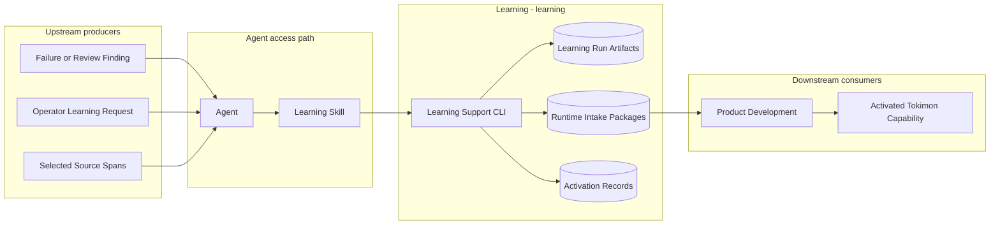
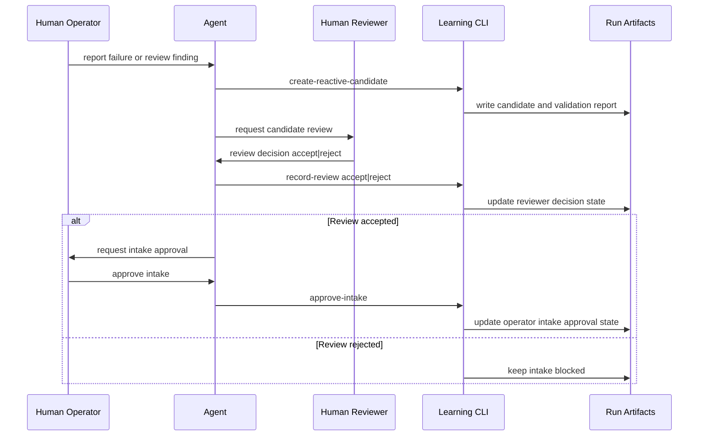
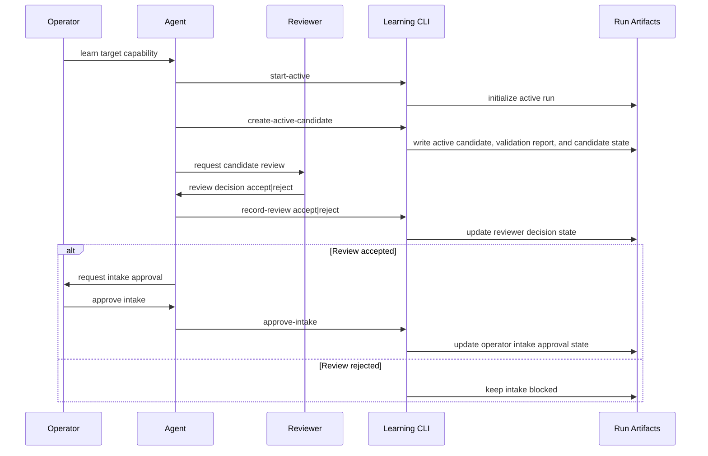
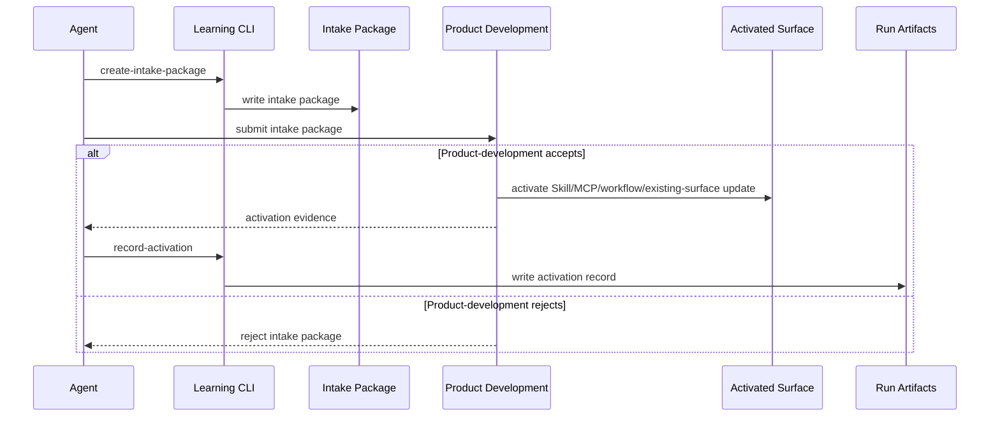

# Learning - Containers

## Contents

1. [Overview](#overview)
2. [Container Diagram](#container-diagram)
3. [Containers](#containers)
4. [Key Interactions](#key-interactions)
5. [Security & Trust](#security--trust)
6. [Data Stores](#data-stores)
7. [References](#references)

## Overview

Learning (`learning`) is an agent-driven, CLI-backed workflow that turns operator-approved Reactive Learning and Active Learning evidence into product-development activation work.
It does not create a top-level knowledge shelf; a successful learning output is an activated Skill, MCP, workflow, or update to an existing Tokimon capability.

At a high level, the AI agent uses the Learning skill to turn approved learning evidence into product-development activation work.
The Learning support CLI validates candidate packets, creates intake packages, and records activation proof after product-development accepts the resulting capability.

**Responsibilities**
- Capture Reactive Learning from concrete failures, corrections, test failures, code review findings, or document review findings.
- Capture Active Learning from explicit operator learning requests with selected sources, target capability, pressure scenario, and exact source spans.
- Reject candidate packets that lack source evidence, pressure scenario, scope, negative scope, claim boundary, independent review, or operator intake approval.
- Create runtime product-development intake packages that product-development may activate as Skill, MCP, workflow, or existing-surface updates.
- Record activation evidence proving the learning result entered a visible Tokimon capability with accepted product-development artifacts and verification evidence.

**Non-responsibilities**
- Do not auto-promote candidate packets into active product behavior.
- Do not publish accepted learning notes as canonical repository guidance.
- Do not treat GitHub score, general repository browsing, startup memory observations, or open-ended repo mining as accepted learning evidence.
- Do not fabricate Reactive Learning if no real failure occurred.
- Do not load learning artifacts at startup.

## Container Diagram

## Containers

### Learning Support CLI

- **Type:** Workflow Runtime
- **Responsibility:** Validate candidate packets, record lifecycle decisions, create intake packages, and record activation evidence.
- **Technology:** `.venv` Python.
- **Data:** Read/write local runtime artifacts under `.tokimon/workflow/learning/`.
- **Key interfaces:**
  - Operator entrypoint:
    - `.venv/bin/python -m tokimon.workflow.learning`
  - Contract command:
    - `contract --json`
  - Candidate lifecycle command family:
    - run initialization
    - candidate creation and validation
    - review and intake approval recording
  - Promotion command family:
    - intake package creation
    - activation recording
    - acceptance validation

### Learning Run Artifacts

- **Type:** Data Store
- **Responsibility:** Preserve local per-run evidence for candidate validation, review, intake package creation, activation, and acceptance checks.
- **Technology:** JSON files under `.tokimon/`.
- **Data:** Owned runtime artifacts under `.tokimon/workflow/learning/runs/<run_id>/`.
- **Key interfaces:**
  - Run root:
    - `.tokimon/workflow/learning/runs/<run_id>/`

### Intake Package Runtime Store

- **Type:** Data Store
- **Responsibility:** Hold operator-approved product-development intake packages until product-development accepts or rejects the requested capability activation.
- **Technology:** JSON files under `.tokimon/`.
- **Data:** Owned runtime artifacts under `.tokimon/workflow/learning/intake-packages/` or the current run directory.
- **Key interfaces:**
  - Intake package root:
    - `.tokimon/workflow/learning/intake-packages/`

## Key Interactions

### Reactive Candidate Review

1. The operator reports a concrete failure, correction, test failure, code review finding, or document review finding to the Agent.
2. The Agent classifies the trigger as Reactive Learning and creates a candidate packet with before/after evidence, pressure scenario, scope, negative scope, and claim boundary.
3. The Agent uses the CLI to validate the packet, record reviewer acceptance or rejection, and record operator intake approval only for accepted candidates.

### Active Candidate Review

1. The operator asks Tokimon to learn a target capability from selected sources.
2. The Agent scouts exact source spans, defines a pressure scenario, and records the before/after delta.
3. The Agent uses the CLI to validate that the packet is source-grounded and not open-ended repo mining, then records the candidate state and validation report.
4. The Agent requests reviewer acceptance and records operator intake approval only for accepted candidates.

### Promotion and Activation

1. Operator-approved candidate evidence becomes a runtime product-development intake package.
2. The Agent submits the intake package to product-development, which accepts or rejects it through normal design, implementation, audit, and acceptance gates.
3. The Agent records activation evidence against the same Learning run and run-local intake package only after the accepted result is active as a Skill, MCP, workflow, or existing-surface update.

### Consumption Patterns

**Primary consumers:** Product-development and agents consume Learning intake packages, activation evidence, and acceptance status.

**Dependencies consumed:** Repository Components provide activation outcomes and audit findings used as operator-selected evidence; Agent Interfaces provide Learning activation and candidate-scoping guidance.

## Security & Trust

- Learning separates candidate evidence from active product behavior so unreviewed notes cannot become capability.
- Operator intake approval is required before candidate evidence can produce an intake package.
- Product-development activation proof must name the activated surface and include accepted product-development status, summary, artifacts, and verification evidence.
- Candidate packets, intake packages, and activation records must be reviewable local artifacts before they can become product-development evidence.
- Local runtime artifacts remain under `.tokimon/` and must not contain secrets.

## Data Stores

- **Owned stores:**
  - `.tokimon/workflow/learning/runs/`
  - `.tokimon/workflow/learning/intake-packages/`

- **Dependency stores:** Learning may read operator-selected evidence artifacts from concrete paths named in candidate packets, including workflow run artifacts under `.tokimon/workflow/*/runs/` and repository docs or code paths selected by the operator.

## References

- L1 Context: `docs/c4/level-1-context/workflow-context.md`
- Guidelines: `docs/guidelines/document-guidelines.md`
- Guidelines: `docs/guidelines/c4-document-guidelines.md`
- Guidelines: `docs/guidelines/helix.md`
