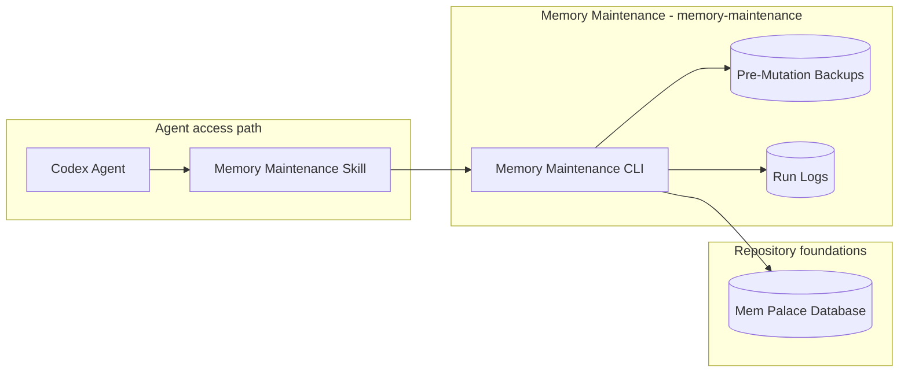
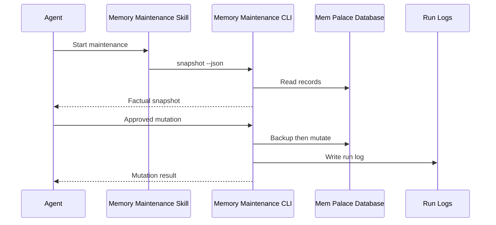

# Memory Maintenance - Containers

## Contents

1. [Overview](#overview)
2. [Container Diagram](#container-diagram)
3. [Containers](#containers)
4. [Key Interactions](#key-interactions)
5. [Security & Trust](#security--trust)
6. [Data Stores](#data-stores)
7. [References](#references)

## Overview

The memory maintenance workflow (`memory-maintenance`) is the repeatable local process for keeping Mem Palace useful without turning deterministic scripts into semantic judges.
Its purpose is to provide factual snapshots, safe mutation commands, backups, run logs, and deterministic repair so the memory-maintenance skill can make the fuzzy cleanup decisions.

At a high level, the workflow gives the memory-maintenance skill factual snapshots, approved mutations, and repair support while leaving semantic cleanup judgment to Codex.
It writes maintenance run logs under `.tokimon/workflow/memory-maintenance/`.

**Responsibilities**
- Emit raw Mem Palace records with aggregate counts and exact duplicate groups.
- Provide safe delete and weight-update commands for unpinned records.
- Back up the memory database before every mutation.
- Write JSONL run logs under the local workflow state root.
- Rebuild deterministic indexes and report schema/count integrity.
- Leave fuzzy duplicate, stale-context, and importance judgments to Codex.

**Non-responsibilities**
- Do not make semantic keep/delete decisions in Python.
- Do not mutate pinned records.
- Do not use an in-repo LLM API client.
- Do not soft-delete records or maintain a separate record state.

## Container Diagram

## Containers

### Memory Maintenance CLI
- **Type:** CLI Runtime
- **Responsibility:** Provide factual snapshots, safe mutations, and repair commands.
- **Technology:** `.venv` Python CLI.
- **Data:** Mem Palace records, aggregate counts, exact duplicate groups, backups, and run logs.
- **Key interfaces:**
  - Operator entrypoint:
    - `.venv/bin/python -m tokimon.workflow.memory_maintenance`
  - Command families:
    - factual snapshots.
    - approved mutations.
    - deterministic repair.
  - Runtime surfaces:
    - `.tokimon/memory/memory.db`
    - `.tokimon/workflow/memory-maintenance/`

### Mem Palace Database
- **Type:** Data Store
- **Responsibility:** Store local durable memory rows and retrieval metadata.
- **Technology:** SQLite under `.tokimon/memory/`.
- **Data:** Memory records, temporal entity facts, FTS index, usage fields, and metadata.
- **Key interfaces:**
  - Memory maintenance command family:
    - read-only snapshots, approved mutations, and deterministic repair.

## Key Interactions

### Snapshot and Approved Mutation
1. The agent reads `skills/memory-maintenance/skill.md` and requests a factual snapshot.
2. The workflow emits Mem Palace records, counts, and exact duplicate groups without semantic judgments.
3. Codex chooses any cleanup action.
4. The workflow creates a pre-mutation backup and applies approved deterministic delete, weight-update, or repair commands.
5. The workflow writes a local run log with the mutation result.

### Consumption Patterns

**Primary consumers:** Codex agents consume factual snapshots, mutation results, backups, and run logs through the memory-maintenance skill.

**Dependencies consumed:** Repository Components provide Mem Palace records for approved maintenance commands.

## Security & Trust

- The workflow uses no credentials, browser sessions, cookies, API keys, or external auth.
- Pre-mutation backups are required before every mutation.
- Pinned memory records must not be mutated by the maintenance commands.
- Semantic keep/delete/importance decisions stay with Codex, not deterministic Python.

## Data Stores

- **Owned stores:**
  - `.tokimon/workflow/memory-maintenance/runs/`
  - `.tokimon/workflow/memory-maintenance/backups/`
- **Dependency stores:**
  - `.tokimon/memory/memory.db`

## References

- L1 Context: `docs/c4/level-1-context/workflow-context.md`
- Memory L2 Container: `docs/c4/level-2-containers/memory/mem-palace.md`
