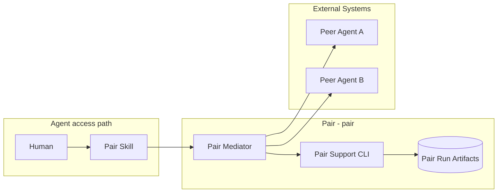
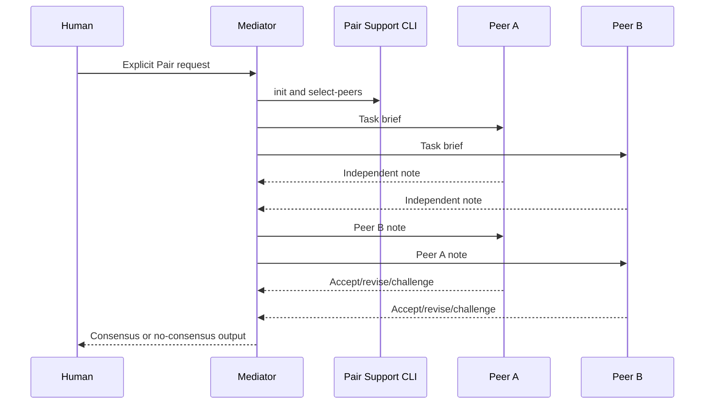

# Pair - Containers

## Contents

1. [Overview](#overview)
2. [Container Diagram](#container-diagram)
3. [Containers](#containers)
4. [Key Interactions](#key-interactions)
5. [Security & Trust](#security--trust)
6. [Data Stores](#data-stores)
7. [References](#references)

## Overview

Pair (`pair`) is a human-invoked Agent collaboration workflow.
It coordinates exactly two Peer Agents for planning, review, implementation review, or other tasks where independent Agent work and mutual challenge should improve the result.

At a high level, the Mediator coordinates a two-Peer run from setup through note exchange to consensus or no-consensus delivery.
The deterministic support CLI owns structure and validation; Peers own technical judgment.
Codex uses two native subagents by default; local Codex and Claude provider CLIs remain explicit alternatives.

**Responsibilities**
- Start a Pair run only when the human explicitly asks for Pair.
- Select exactly two valid Peers for the current task and record why they were selected.
- Preserve Peer independence before note exchange.
- Route Peer notes, objections, revisions, and final text through a neutral Mediator.
- Record state at round boundaries so interrupted work can resume.
- Deliver structured consensus or no-consensus output backed by recorded Peer evidence, without pasting the full transcript into the final response.
- Store transcript and run artifacts under `.tokimon/workflow/pair/runs/<run_id>/`.

**Non-responsibilities**
- Do not run Pair automatically for ordinary requests.
- Do not let the Mediator judge technical correctness, choose a winner, hide disagreement, or replace Peer consensus.
- Do not turn the support CLI into a provider orchestrator.
- Do not adjudicate consensus from Python validation.

## Container Diagram

## Containers

### Pair Mediator
- **Type:** Workflow Runtime
- **Responsibility:** Process stewardship, Peer selection, note routing, state updates, and final delivery packaging.
- **Technology:**
  - Current Agent runtime.
  - Repository evidence and selected native-subagent or local-cli Peer channels.
- **Data:** Task brief, Peer notes, round state, objections, external clarification answers, and final status.
- **Key interfaces:**
  - Selected Peer channels.
  - Artifact directory.
  - Final human response.

### Peer Agents
- **Type:** External System
- **Responsibility:** Independently research, plan, review, challenge, implement, or inspect according to the Pair phase.
- **Technology:**
  - Codex-native subagents.
  - Local Codex or Claude provider CLIs.
- **Data:** Peer prompt, task context, Peer workspace, exchanged notes, and review findings.
- **Key interfaces:**
  - Mediator-routed prompt.
  - Mediator-routed note exchange.

### Pair Support CLI
- **Type:** CLI Runtime
- **Responsibility:** Declare the workflow contract, initialize run artifact structure, resolve the configured Peer pair, read state, and structurally validate artifacts and terminal consensus evidence.
- **Technology:** `.venv` Python CLI.
- **Data:** `state.json`, `artifacts.json`, `transcript.md`, Peer workspaces, and round directories.
- **Key interfaces:**
  - Operator entrypoint:
    - `.venv/bin/python -m tokimon.workflow.pair`
  - Command families:
    - contract rendering and run initialization.
    - Peer selection and status reads.
    - structural validation.
  - Artifact surfaces:
    - `.tokimon/workflow/pair/runs/<run_id>/`

## Key Interactions

### Pair Consensus Run
1. The human explicitly invokes Pair.
2. The Mediator initializes run artifacts and selects exactly two Peers from the configured `pair` settings section.
3. The Mediator starts the selected Peers independently, creating all native subagents before collecting either first note.
4. Peers work independently, exchange notes through the Mediator, and revise or accept final text.
5. Consensus requires at least one independent-note round, a later exchange round, `consensus.md`, and `consensus_status` evidence that records artifact paths, Peer acceptances, and the final text SHA-256.
6. The run ends when both Peers explicitly accept the same final text or no consensus remains.
   Pause for human direction if the round limit is reached without consensus.

### Consumption Patterns

**Primary consumers:** Humans and mediators consume consensus/no-consensus output, artifact paths, and support-CLI run-state surfaces.

**Dependencies consumed:** Repository Components provide workflow and Pair skill contracts and local Pair run state and artifacts; Agent Interfaces provide task-specific Peer capabilities when selected and explicit Pair activation.

## Security & Trust

### Auth Boundary

- Pair does not own provider credentials; Peer-specific auth stays with the selected Agent runtime or provider CLI.
- Native subagents inherit the current Agent runtime's sandbox and approval policy; Peer creation does not grant additional authority.
- Prompts, transcripts, final summaries, and context packages must not include secrets, cookies, API keys, bearer tokens, or sensitive auth material.
- Unique irreversible side effects are executed once by the Mediator only after Peer convergence on the content or action.

## Data Stores

- **Owned stores:**
  - `.tokimon/workflow/pair/runs/<run_id>/`
- **Dependency stores:**
  - `.tokimon/settings.local.json`
  - Selected Peer workspaces and provider session artifacts.

## References

- L1 Context: `docs/c4/level-1-context/workflow-context.md`
