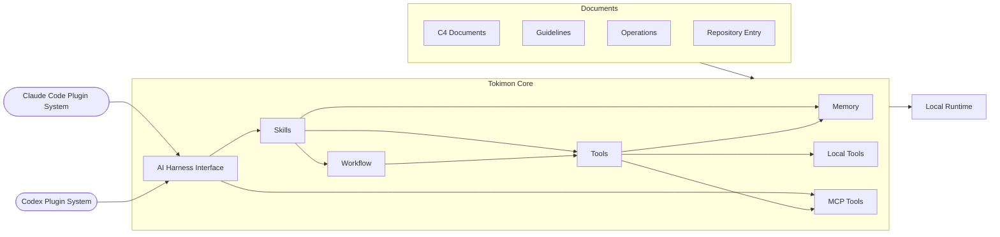

# Tokimon Repository Guidelines

This file owns top-level routing for Tokimon repository capabilities, runtime policy, and documentation ownership.
Detailed capability catalogs and command contracts live in the C4 documents.

## Overview

## Repository Routing

Use this file to choose the next owning document.

| Area | Read next | Implementation or package root | Runtime root |
| --- | --- | --- | --- |
| Startup | `AGENTS.md` | - | - |
| Operations | `docs/operations/` | - | - |
| Guidelines | `docs/guidelines/` | - | - |
| Configuration | `docs/guidelines/configuration-guidelines.md` | `tokimon/settings.py`; `tokimon/settings.example.json` | `.tokimon/settings.local.json` |
| Memory | `docs/c4/level-1-context/memory-context.md`; `docs/c4/level-2-containers/memory/`; `docs/c4/level-3-components/memory/` | `tokimon/memory/` | `.tokimon/memory/` |
| Tools | `docs/c4/level-1-context/tools-context.md`; `docs/c4/level-2-containers/tools/`; `docs/c4/level-3-components/tools/` | `tokimon/tools/` | `.tokimon/tools/` |
| Workflow | `docs/c4/level-1-context/workflow-context.md`; `docs/c4/level-2-containers/workflow/`; `docs/c4/level-3-components/workflow/` | `tokimon/workflow/` | `.tokimon/workflow/` |
| Skills | `docs/c4/level-1-context/skills-context.md`; `docs/c4/level-2-containers/skills/` | `skills/` | `.tokimon/skills/` |
| AI Harness Interface | `docs/c4/level-1-context/ai-harness-interface-context.md`; `docs/c4/level-2-containers/ai-harness-interface/`; `docs/c4/level-3-components/ai-harness-interface/` | `tokimon/ai_harness_interface/` | `.tokimon/ai-harness-interface/` |
| Runtime | Runtime Policy below | - | `.tokimon/` |

## Runtime Policy

- Python and `pip` are allowed only inside Tokimon's repository `.venv`.
  When using a linked worktree, reuse the primary worktree's `.venv` instead of creating a worktree-local virtualenv.
  A wheel uses its owning user-created Python environment and the bundled `share/tokimon/` workspace; the AI Harness Interface component contract owns that distribution layout.
- `.tokimon/` is the single ignored local runtime root.
  When using a linked worktree, keep persistent local runtime state in the primary worktree's `.tokimon/`.
  Do not create worktree-local runtime state.
- Do not create additional top-level ignored runtime directories such as `.tmp/` or `sandbox/`.

## Boundary Notes

- C4 documents own accepted architecture, ownership, command contracts, and capability boundaries.
- Guidelines own repo-wide rules and review standards.
  Guidelines remain under `docs/guidelines/`; they are not a C4 context.
- Configuration owns shared machine-local settings rules.
  Feature-specific command contracts stay in their owning C4 docs.
- Operations own execution procedures for repeatable repository work.
- Repository entry files route agents to the minimal owning docs before implementation.
- AI Harness Interface owns the Tokimon content overlay for the Codex and Claude Code plugin contracts as target-platform adapters.
  Current OpenAI plugin schemas and plugin-creator guidance define Codex package shape; the adapter supports built-in authoring when legacy helpers are absent.
  The Claude Code plugin CLI owns Claude plugin-shape validation and account-level install mechanics.
  Package output is generated under `.tokimon/ai-harness-interface/<target-platform>/` from canonical live sources.
