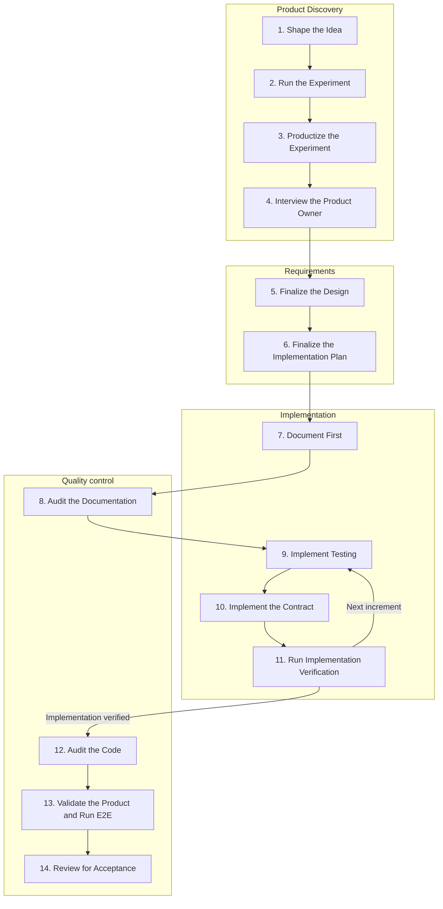

# Product Development

## Contents
- [Purpose](#purpose)
- [Invocation](#invocation)
- [Loop Phases](#loop-phases)
- [Adjustment Rule](#adjustment-rule)
- [Checkpoint Command](#checkpoint-command)
- [Continuity and Artifacts](#continuity-and-artifacts)
- [Related Surfaces](#related-surfaces)

## Purpose

This skill owns product development through acceptance and handoff of the uncommitted implementation.
It also owns the checkpoint command.
The human operator owns commit and PR creation after handoff.
It keeps handoffs and guardrails aligned as work moves between agents, documents, code, tests, and runtime evidence.
It preserves user intent, confirmed facts, design decisions, implementation plans, review findings, continuity checkpoints, and acceptance expectations.

The primary agent analyzes and reviews the work in the active Agent runtime using direct repository and runtime evidence.
Use additional reviewers when the task and runtime authorize them.

Start the loop when:
- a promising idea, prototype, experiment, or agent-assisted result should become a product
- the user wants to move from "this worked" to "what product should this become"
- product development work needs design, planning, documentation, implementation, review, and acceptance continuity

The loop is complete when:
- the product promise is recovered and preserved
- design and implementation plan are aligned
- required documentation and implementation match the accepted design
- quality review has no blocking findings for the accepted scope
- required implementation and runtime checks are complete for the final candidate, including necessary E2E evidence
- acceptance review passes against the final design, implementation plan, confirmed user decisions, and evidence
- the uncommitted implementation and verification evidence are ready for human handoff

## Invocation

### Default Loop

Run or resume the loop from the phase supported by the evidence.

### `checkpoint` Command

Use `checkpoint` for the state and readiness questions defined below.

## Loop Phases

### Flow



### 1. Shape the Idea

Discuss the initial idea until it is clear enough to run an experiment.
Use any experiment notes or conversation summary supplied by the user as input.

### 2. Run the Experiment

Define and run an experiment that produces useful evidence about the product direction.
Continue only when the experiment provides enough evidence that the product direction is worth developing.

### 3. Productize the Experiment

Turn a proven experiment into an initial design for a repeatable product capability.

Procedure:
1. Recover the experiment.
   State what was proven and the context that made it work.
2. Extract product intent.
   State who the capability serves and why it should repeat.
3. Separate durable from incidental.
   Keep reusable product facts and discard one-off experiment details unless they reveal durable constraints.
4. Draft the product shape.
   Describe the draft product well enough for design review.
5. Review the product shape.
   Challenge whether the experiment supports the proposed capability, scope, constraints, and next decision.
   The primary agent performs this review by default; use an independent reviewer when authorized and available.
   Invoke the `pair` skill only when the human explicitly opted into Pair collaboration.
   Record who reviewed the proposal and whether the review was independent.
   Carry useful review exchange into the synthesis when it explains revisions, risks, or open questions.
6. Synthesize the productization output:
   - product name
   - capability hypothesis
   - experiment evidence
   - target user and use case
   - product scope
   - non-goals and assumptions
   - durable constraints
   - acceptance expectations
   - review approach and outcome
   - open questions
   - next decision

### 4. Interview the Product Owner

Use: `grill-me` skill

Use `grill-me` to question the human operator about product intent, scope, user value, constraints, and tradeoffs.
Keep the interview in repository context when local project details matter.

### 5. Finalize the Design

Turn the productized experiment and clarified product intent into a design.
Review and refine it, then record the final design and the reasoning behind important decisions.

### 6. Finalize the Implementation Plan

Turn the final design into an implementation plan.
Inspect repository instructions, existing tests, verification scripts, CI configuration, and runtime or deployment guidance.
Use that evidence to select the checks and runtime needed for this change.
Record:

- acceptance criteria and required pre-commit evidence
- unit, integration, and E2E scenarios, with commands and expected results where applicable
- runtime targets, setup and access requirements, and manual checks
- existing coverage, verification gaps, and any checks outside the confirmed scope

Review design-plan alignment, then record the final plan and the reasoning behind important decisions.

### 7. Document First

Write the contract documents before implementation.
Create or update the owning documentation when the product changes contracts, behavior, boundaries, or operator expectations.
Include the agreed behavior and acceptance criteria in the owning contract.

### 8. Audit the Documentation

Use: `document-audit` skill

Run `document-audit` to verify that the documented contract is complete and aligned with the accepted design and implementation plan.
Check that acceptance criteria and the verification plan cover the promised behavior.
Use `document-audit-fix` when blocking findings need documentation edits, verification, and a fresh re-audit loop.
Resolve blocking findings before code changes.

### 9. Implement Testing

Write or update behavior tests for the current implementation increment through its public contract.
Use test-first development for new behavior and bug fixes when it provides useful evidence.
Run the tests and confirm the intended failure before implementation when test-first development applies.
Setup failures do not prove that the intended behavior is missing.

Choose suitable verification for documentation changes, already-covered behavior, and changes that need external runtime evidence.
Prepare E2E scenarios early and implement them when their runtime setup is available.
Repeat phases 9-11 for each increment.

### 10. Implement the Contract

Implement against the finalized documents.
Keep the code aligned with the accepted design, implementation plan, and owning documentation.
Make the current increment's behavior tests pass, then refactor while keeping them green.

### 11. Run Implementation Verification

Run the relevant unit, integration, and regression tests selected in the plan.
Run repository-required checks, such as lint, type checks, and builds.
Expand verification when the change affects public or shared boundaries.
Record exact commands, results, and unresolved failures.
Complete required implementation verification before code audit.

### 12. Audit the Code

Use: `code-audit` skill

Run `code-audit` when implementation or tests change, or when the confirmed scope requires implementation review.
Otherwise, record why code audit is not applicable.
The audit checks the implementation and tests against the documented contract and quality bar.
Resolve blocking findings before runtime validation and acceptance; use `code-audit-fix` when a fix and re-audit are needed.
Reopen product scope only for findings that expose a real product issue.

### 13. Validate the Product and Run E2E

Run the product checks selected in the plan.
When the agreed outcome requires runtime evidence, verify it in the appropriate repository-defined runtime.
Inspect changed product surfaces and user workflows directly.
For changed web interfaces or customer journeys, inspect the actual behavior and user experience in the browser.
Verify other changed runtime behavior through the relevant product entrypoints.

Run the end-to-end checks required by the confirmed scope and fix failures.
When fixes change code, rerun affected implementation tests and audits.
E2E checks may run earlier; final evidence must cover the final candidate and relevant runtime.

Record why E2E is out of scope when it is not needed to prove the agreed outcome.
Missing E2E automation does not waive required end-to-end evidence.
Use an appropriate automated or manual method, or report the verification blocker.

### 14. Review for Acceptance

Judge the actual result against the current promise, direct evidence, accepted design, implementation plan, and confirmed user decisions.
Treat newer user instructions and confirmed facts as authoritative over older plans.
Make the final judgment after required implementation and runtime verification is complete.

Procedure:
1. Recover the promise.
   State the current acceptance target for the uncommitted implementation before judging the work.
2. Inspect the evidence.
   Verify the actual result directly, not through summaries, intent, or checklist presence.
3. Review the agreed acceptance checks.
   Confirm that the checks from the plan and owning contract prove the current promise and handoff.
   Include checks for:
   - Current user need is respected.
   - Confirmed updates are reflected.
   - Promised behavior is demonstrated.
   - Changed surfaces are inspected directly.
   - Documented contracts are satisfied.
   - Runtime state supports the user outcome.
   - Unresolved blockers are identified.
4. Execute the checks.
   Use existing verification evidence for the unchanged candidate and runtime.
   Run additional checks where evidence is missing, stale, or required by repository policy.
5. Make the judgment.
   Decide accepted, conditionally accepted, or rejected.
   Treat unresolved promised behavior as a blocker and unrelated improvements as follow-up.
   Missing required verification or human confirmation blocks acceptance.
   Use conditional acceptance only for confirmed non-blocking conditions.
6. Synthesize the acceptance output:
   - acceptance target
   - acceptance judgment
   - evidence summary
   - verification log
   - blockers or follow-ups
   - handoff state
7. Hand off for human commit.
   Report the checkout, branch, changed files, and remaining human actions.
   Include verification commands, results, and the runtime target when applicable.
   Leave the implementation uncommitted.

## Adjustment Rule

Apply this rule in every phase.
When a phase reveals a material design, plan, contract, or product problem, return to the owning design, plan, or document.
Review material adjustments when useful.
Escalate material product decisions to the human operator.
Update the owning contract before changing implementation.
Rerun affected tests, audits, and runtime checks before acceptance.

## Checkpoint Command

`checkpoint` reports the current product-development state and next concrete move.

Use `checkpoint` when the user asks to resume, locate the current phase, decide the next step, or check closeout readiness.

Use that evidence before planning or judging the next step.
Do not checkpoint from summaries alone when the relevant source material is available.
If expected source material is missing or inaccessible, report that as a readiness gap and limit the recommendation to the evidence inspected.

Checkpoint output:
- current phase
- recovered product promise
- evidence inspected
- readiness gaps
- recommended next action
- phase, related skill, or document to use next
- required human decisions
- handoff notes

## Continuity and Artifacts

Use one stable kebab-case `<scope>` for the product area.

Tokimon-owned continuity state stays in the Tokimon runtime root.
When the current repository is only the task subject, do not resolve the paths below against that repository.
Do not add `.tokimon/` to that repository's `.gitignore` for Tokimon product-development state.

Resolve `<project-id>` from `project.project_id` in this read-only contract:

```bash
{{tokimonCommand}} -m tokimon.workflow.code_audit contract --project-root "<task-checkout>" --json
```

Linked worktrees share the project identity.
Read and write continuity state only through the selected project's scope path; an existing link may preserve history at its original location.

```text
.tokimon/skills/product-development/projects/<project-id>/<scope>/
```

Keep `product-development.log` in that directory and update it before a phase handoff or stop.
Each entry preserves the current promise, user decisions, and actual task checkout.
It also records inspected evidence, conclusions, artifact paths, blockers, and the next step.

## Related Surfaces

- Document-first method: `docs/guidelines/helix.md`
- Optional Pair collaboration: `pair` skill at `skills/pair/skill.md`
- Product interrogation: `grill-me` skill at `skills/grill-me/skill.md`
- Documentation audit: `document-audit` skill at `skills/document-audit/skill.md`
- Documentation remediation: `document-audit-fix` skill at `skills/document-audit-fix/skill.md`
- Code audit: `code-audit` skill at `skills/code-audit/skill.md`
- Code-audit remediation: `code-audit-fix` skill at `skills/code-audit-fix/skill.md`
